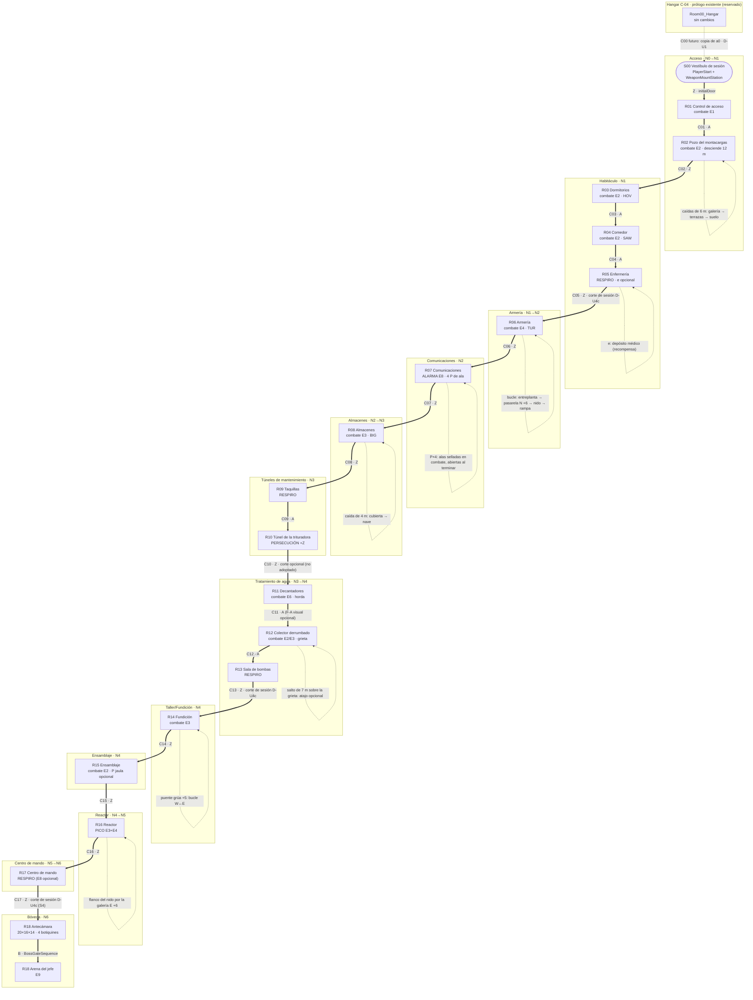
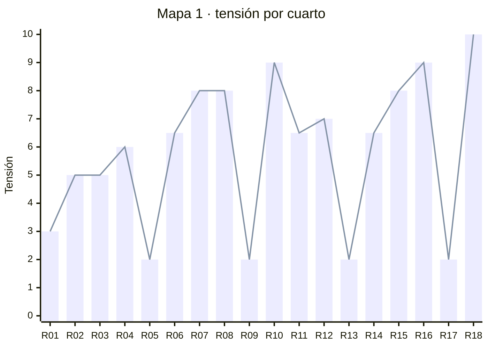

# MAPA 1 · 01 · Estructura (R1)

**Estado:** F1, diseño en papel. Autor: R1 (opus), 18/11/2026. Nada se ha construido.

**Alcance:** solo lectura del proyecto; único archivo escrito: este. No se abrió Unity, no se usó la CLI ni git que escriba.

**Contratos usados:**
- `MAP01_DESIGN.md` §3–§5 (v0).
- `03_ENCUENTROS.md` Parte A (§A4, §A5, §A6 y §A7). Lo que pide R3 a Estructura está incorporado; lo que no se cumple tal cual se indica en el cuarto y en §13.
- `04_PUERTAS.md` §P1 y §P4. **Los tamaños de puerta de R4 sustituyen al v0 donde difieren:**
  - Z con banda de muro de 14 × 7,6 × 1,5 m, volumen libre de 6 m en el lado de la sala y techo ≥ 8 m junto a la puerta.
  - A con techo ≥ 6 m junto a la puerta.
  - E solo como paso interno, nunca como esclusa.
  - P con casete en la cara exterior a la arena.
  - F solo en rutas opcionales.
  - B dentro de la escena del jefe, con antecámara de 20 × 16 × 14 m. [reconciliación] Se ensancha a 20 × 22 × 14 (CC-13).
- [reconciliación] Partes B de `03_ENCUENTROS.md` (§B7), `04_PUERTAS.md` (§Q5) y `05_ILUMINACION.md` (§L9.2) reconciliadas. Cada cambio está marcado «[reconciliación]» y resumido al final de §13.

**Marcas:**

| Marca | Significado |
|---|---|
| **[DECISIÓN USUARIO]** | Lo decide el usuario en la PARADA de F1 |
| **[PARA R3]**, **[PARA R4]**, **[PARA R5]**, **[PARA R2]** | Propuesta o requisito para ese rol |
| **[R0]** | Lo aprueba o lo ejecuta el coordinador |
| **[VALIDAR F2]** | Cifra de papel que el validador de `StructureAuthoring` o una prueba en Play deben confirmar |
| **[DEPENDE DEL JEFE]** | Depende del concepto de jefe que elija el usuario |

**Croquis:** planta con el norte (+Z) arriba. Salvo que se indique otra cosa, 1 carácter = 2 m en X y 1 fila = 4 m en Z. Mandan las cifras del texto: el croquis es orientativo.

| Símbolo | Significado |
|---|---|
| `#` | Muro |
| `.` | Suelo libre |
| `=` | Plataforma maciza (cota en el texto) |
| `^` | Pasarela sobre pilares; debajo hay suelo utilizable |
| `/` `\` | Rampa o escalera con rampa de colisión |
| `b` | Cobertura baja (1,1–1,2 m) |
| `H` | Cobertura alta (≥ 2,4 m) |
| `O` | Pilar o columna |
| `L` | Landmark |
| `S` | Zona de spawn normal |
| `B` | Slot de Big Bot (Ø 5 m) |
| `T` | Nido de torreta |
| `E` / `X` | Entrada / salida |
| `P` / `p` | Persiana interna (P) |
| `e` | Escotilla interna (E) |
| `R` | Volumen de `Map01StageRelease` |
| `~` | Agua |
| espacio | Hueco o foso |
| `\|` | Tabique |
| `+` | Botiquín |

---

## 1. Resumen

1. **17 cuartos y la arena del jefe: 18 etapas** (R01–R18) en **12 zonas** más el hangar. Recorrido lineal: 17 esclusas (C01–C17) más el vestíbulo de arranque S00, todo en un plano de mundo sin solapes, comprobado por script (§5.3). Extensión: x −17…294, y −41…10, z −70…783 m.
2. **Mezcla de funciones:**
   - 11 cuartos de combate.
   - 1 evento de alarma: R07.
   - 1 persecución en +Z del mundo: R10.
   - 4 respiros: R05, R09, R13 y R17.
   - La Bóveda del jefe: R18, con su antecámara dentro de la escena.
3. **Ritmo en diente de sierra:** nunca más de dos cuartos de tensión ≥ 7 seguidos, y un respiro cada 3–4 combates (§8). Duración estimada: **≈ 52 min** más ≈ 1 min de esclusas.
4. **Introducción de enemigos alineada con R3 (§A2.1):**
   - Carroñero → T-07 con tutorial de ejecución → HoverBot → SawBot → respiro.
   - Torreta (Armería) → alarma (Comunicaciones) → Big Bot (Almacenes) → T-07 Mech.
   - Persecución (Túneles) → horda (Tratamiento de agua) → combinaciones (Taller, Ensamblaje, Reactor) → jefe.
5. **El búnker desciende de 0 a −37 m** en siete niveles. Todo el desnivel se gana **dentro** de los cuartos, con galerías de entrada y rampas; las esclusas son siempre planas.
6. **Todos los cuartos tienen yaw 0.** El AABB local coincide con el de mundo y los `Bounds` de `CombatTwoRoomsLab`, `finishZ` y las Z de las grietas se obtienen sumando el origen.
7. **Hangar:** queda **reservado y sin tocar**. Map01 arranca en el vestíbulo S00, que está justo donde termina la cámara a0 del hangar. Así el enlace posterior no obliga a mover nada (D-U1).
8. **Salas actuales:** no se copia ninguna escena. R10, R12, R14, R15 y R16 **derivan** de Pursuit05, Room02, Room01, Room03 y Room04: se transcriben sus medidas y piezas firma a `Data/Structure`, con los defectos M7–M19 corregidos (D-U2, §10).
9. **Reglas nuevas (§2.3):**
   - Coberturas bajas a 1,1–1,2 m (por `agentClimb` 1,0).
   - Holguras «0 o ≥ 4 m» (≥ 5 m donde hay Big Bot).
   - Pasarelas con paso inferior a +5 m.
   - Techo de la sala según la clase de puerta.
   - Superficies pisables a ≤ 3 m de NavMesh conectado.
   - Slots a ≥ 10 m de la entrada.
10. Hacen falta **componentes nuevos** pequeños (lista abajo). Ninguno toca sistemas existentes.

### Decisiones para el usuario

| # | [DECISIÓN USUARIO] | Opciones | Recomendación de R1 |
|---|---|---|---|
| **D-U1** | Hangar y etapa 0 | (a) Map01 empieza en R01, con el vestíbulo de sesión S00, y el hangar queda reservado en el plano para enlazarlo después. (b) Hangar como etapa 0 ya en F2, con una copia de la cámara a0 como C00. (c) Map01 sin hangar, para siempre | **(a).** S00 está en (0; 0; −70…−55): empieza donde termina el vestíbulo de a0 (`HangarTransitAuthoring.cs:36`, `VestibuleEnd = −70`). Más adelante basta con anteponer `Room00_Hangar` **sin modificarlo** y una copia de a0 en `Map01_Campaign` (R4 DU-3), con `prologueStages = 1`. Así F2 no depende de la cinemática ni de la zona protegida, y nada protegido se mueve |
| **D-U2** | Reutilizar salas actuales | (a) **Derivar por datos:** se transcriben medidas y piezas firma a JSON y `StructureAuthoring` genera escenas nuevas. (b) Copias de escena (`Room01_Foundry_v2`, `Room03`, `Room04_Reactor_v2`, `Pursuit05`), desplazadas y reorganizadas por capas. (c) Diseño nuevo sin referencias | **(a)** para Room01 → R14, Room03 → R15, Room04 → R16, Pursuit05 → R10 y la grieta de Room02 → R12. **Se reemplazan** Room00b y Room02 (§10). La opción (b) arrastra la cuarentena v35, materiales de la lista roja y raíces sin capa, y obliga a recalcular a mano los campos de mundo |
| **D-U3** | Número de cuartos | 17 + jefe (diseño completo) · 16 + jefe · 15 + jefe | **17 + jefe.** Si falta tiempo se recortan, por este orden: **R09** (su respiro pasa a la bahía de llegada de R10, antes del trigger, donde la estructura ya lo admite) y **R13** (C12 enlazaría el colector con la fundición mediante una Z). Así quedan 15 + jefe, el mínimo pedido. El plano se recalcula con `plan2.py` (§5.3) |
| **D-U4** | Muerte y puntos de control (con D-E2 de R3) | (a) Sin cambios: morir recarga la sesión desde R01, más de 50 min. (b) Checkpoint en cada Z (D-E2 de R3), con código que toca `CombatLabMenu`/`CampaignFlow`. (c) **Cuatro sesiones encadenadas** [reconciliación]: S1 R01–R05, S2 R06–R13, S3 R14–R17 y **S4 R18**. Un componente nuevo, `Map01SessionHandoff`, carga la sesión siguiente; la muerte recarga solo la sesión en curso (`CombatLabMenu.cs:38-40`) | **(c) para F2** (decisión del coordinador, petición 8 de R3): no toca sistemas existentes y cada intento contra el jefe empieza en la antecámara, sin repetir R14–R17. Los cortes caen en **C05, C13 y C17**, todas Z. En la sesión siguiente, la cámara de esa esclusa es la **cámara de arranque**, con las mismas coordenadas y una `WeaponMountStation` (§12.1, R1-14 de R4), porque al cargar otra sesión no se conserva el arma principal (`WeaponMountStation.cs:87`). **C10 queda como corte opcional, no adoptado** (partiría S2 en S2a R06–R10 y S2b R11–R13). **(b) más adelante** si se aprueba |
| **D-U5** | Persiana P de entrada contra la retirada a la esclusa (= DU-6 de R4) | Sí / No | **Sí, en las arenas de combate.** La destino nunca se cierra y la cámara no tiene NavMesh: allí se puede acampar. La estructura reserva en todos los cuartos de combate un **pórtico** con el vano de la P (posición en cada ficha). Si se rechaza, el pórtico queda abierto y no cambia nada más |
| **D-U6** | Big Bot y jefe frente al NavMesh de radio 0,5 (= D-E6 de R3) | (a) Solo reglas de geometría. (b) Además, marcar las rampas y los pasos estrechos con el área integrada **Jump** (índice 2, `NavMeshAreas.asset`) mediante `NavMeshModifierVolume`, y crear una **variante nueva** del Big Bot de Map01 cuyo `areaMask` excluya Jump. (c) Un tipo de agente «Grande», que cambia ProjectSettings | **(a) + (b).** (b) no toca ProjectSettings y evita que el Big Bot planifique por rampas de refugio o pasos estrechos. Hay que verificar en F2 los namespaces de `NavMeshModifierVolume` (paquete y `Assets/NavMeshComponents`; AGENTS.md). (c) solo si F2 demuestra atascos |

### Componentes nuevos que pide la estructura (aprobación [R0])

Todos son nuevos y observan propiedades públicas. Ninguno modifica sistemas existentes.

| Componente | Dónde | Para qué |
|---|---|---|
| `Map01StageRelease` (nombre de R3) | R05, R09, R13 y R17 | Llama a `CampaignRoom.Release()` al entrar en un volumen junto a la salida. Sin él, los respiros son un soft-lock (`CampaignRoom.cs:23`) |
| `ArenaShutter` (P, de R4) | R07 (4 persianas de ala) y los pórticos de entrada (D-U5) | Bajar y subir con `WaveIndex` y `Completed`. Opcional: la jaula de R15 |
| `HatchDoor` (E, de R4) | R05 (opcional) | Escotilla de recompensa en un respiro |
| `Map01SessionHandoff` | Solo con D-U4 (c), en C05, C13 y C17 (C10 opcional) [reconciliación] | Abre la salida de la última etapa de la sesión y carga la siguiente al entrar en la cámara |
| `Map01BossEncounter` y `BossGateSequence` (R3 y R4) | R18 | Jefe, puerta B y fin de mapa |

**Componentes existentes que se reutilizan sin cambios:**

- `CorridorAlarm` en R07.
- `ChaseCorridorEncounter` y `GapFallRecovery` en R10 y R12.
- `WeaponMountStation` en S00: R3 exige el arma principal antes del primer T-07.

---

## 2. Métricas y reglas derivadas

### 2.1 Métricas del jugador y de los agentes (confirmadas)

Fuente: `00_INVENTARIO.md` §2 y §0, verificadas por el coordinador. Ningún dato está medido en Play: son derivados de valores serializados.

| Métrica | Valor | Uso en el diseño |
|---|---|---|
| Suelo / sprint | 13 / 19,5 m/s | Una arena de 50 m se cruza en 2,6–3,8 s |
| Salto | 2,03 m de apex; 0,90 s en el aire; 9,0 m andando y 13,5 m esprintando | Escalones ≤ 1,7 m saltables; huecos |
| Dash | 4,32 m (24 m/s × 0,18 s), 1 por vuelo | Carriles laterales ≥ 6 m |
| Salto + dash | ≈ 11,5 m andando · ≈ 14,6 m esprintando | Huecos infranqueables ≥ 16 m |
| Slide | ≈ 12 m desde el sprint; 0,42 s invulnerable | Carriles ≥ 12 m rectos |
| Cápsula | 1,8 m de pie · 0,9 m agachado · radio 0,35 m | Altura libre; pasos bajos |
| Ojos | 1,44 m de pie · 0,72 m agachado | Coberturas bajas y altas |
| Escalón / pendiente | 0,3 m / 45° | Escaleras ≤ 0,25 m con rampa de colisión |
| Caída sin daño | ≈ 10 m (sin medir) | Caída voluntaria ≤ 8 m; barandilla de 2,4 m si la caída es > 8 m |
| Recogida / ejecución | 2,5 m | Volumen libre alrededor de los slots |
| Agente NavMesh 0 | Radio 0,5, altura 2, pendiente 45°, escalón **1,0** (0,4 en Room01: discrepancia) | Coberturas bajas > 1,0 m; huecos < 1 m cerrados para el NavMesh |
| Big Bot | Radio 2,25 (Ø 4,5), altura 3,05, 1,68 m/s | Pasos ≥ 5 m; slots de Ø 5 × 4,6 m (R3) |
| Alcances | T-07 38 m (detección 45) · Torreta 43,75 m (45,75) · Big Bot 28,6 m · HoverBot 12,5 m | Líneas de visión (§2.5) |

### 2.2 Contrato §5.1: confirmación y endurecimiento

| Regla | v0 | **R1 (F1)** | Motivo |
|---|---|---|---|
| Ancho mínimo de paso | 4 m | **4 m**. Excepción: la E de 2,5 m a ras de suelo, solo en el espesor del marco (R4 DU-7) | — |
| Pasillo de combate | ≥ 6 m | **≥ 6 m** y ≥ 2 carriles de slide de ≥ 12 m por arena | Slide de 12 m y dash de 4,3 m |
| Ruta del Big Bot | ≥ 5 m | **Paso ≥ 5 m; anillo ≥ 6 m; planta E3 ≥ 44 × 48 m** (R3 §A4.4) | Radio de 2,25 m sobre un NavMesh de 0,5 |
| Altura libre de paso | 4,5 m | **4,5 m.** Las pasarelas con paso inferior van a **+5,0 m** (4,5 libres + 0,5 de losa). Las de Room01–04 (3,7–3,8 m) suben a +5 | La cabeza llega a 3,83 m en el apex |
| Altura libre en arenas | ≥ 8 m; plataformas + 4,5 | **Igual**, y además el techo junto a las puertas según R4: **Z ≥ 8 m** en la franja de 6 m (cota de la puerta + 7,6 de banda), **A ≥ 6 m** en la franja de 4 m y **B ≥ 14 m** en la antecámara | Casetes en la cara de la sala (R4 §P1.1) |
| Cobertura baja | 1,0–1,2 m | **1,1–1,2 m** | `agentClimb` 1,0 en ProjectSettings: una caja de 1,0 m puede quedar conectada al NavMesh y los enemigos la pisarían |
| Cobertura alta | ≥ 2,4 m | **≥ 2,4 m de alto y ≥ 3 m de ancho** en las rutas (R3 S9) | Tapa por completo y corta la salpicadura del Big Bot (2,88 m) |
| Saltable sin ayuda | ≤ 1,7 m | **Igual.** Barandilla anticaídas ≥ 2,4 m donde la caída es > 8 m | — |
| Hueco franqueable | 7,5 / 11 / 12 m | **Igual.** En la ruta crítica, grietas de 4 m (R10) o puentes (R12) | — |
| Hueco infranqueable | ≥ 16 m o barrera | Igual | — |
| Carril de slide | ≥ 12 m | **≥ 12 m y ≥ 2 por arena** | — |
| Rampa | ≤ 30° | **≤ 30°; preferente 14–21°.** Rampas de refugio (el Big Bot no sube): **4–5 m** de ancho y marcadas Jump (D-U6) | — |
| Escalera | Peldaños ≤ 0,25 m + rampa de colisión | Igual (patrón `V35_StairRamp`) | — |
| Caída voluntaria | ≤ 8 m | Igual | — |
| Callejones sin salida en combate | Prohibidos | **Igual.** Las alcobas ≤ 8 m de fondo y ≥ 6 m de boca no cuentan como callejón | — |
| Teselas | ≤ 10 m | Igual, también alrededor de los marcos de puerta (R4 §P4.5) | 4 luces por objeto |

### 2.3 Reglas nuevas de R1

| # | Regla | Motivo |
|---|---|---|
| E-1 | **Holgura entre obstáculos.** Entre un obstáculo y un muro u otro obstáculo hay **0 m** (adosado) **o ≥ 4 m**; en zonas de Big Bot, 0 o ≥ 5 m. Prohibidas las ranuras de 1–4 m | M19 (ranuras de 1 m en Pursuit05). Una ranura de 1–4 m es un paso del NavMesh de 0,5 donde se atasca el Big Bot y engancha al jugador |
| E-2 | **Superficies pisables a ≤ 3 m de NavMesh conectado** (R3 S2). Plataformas y entreplantas con rampa; tarimas ≤ 1,7 m solo si ningún punto está a > 3 m del borde conectado | `SafeSpawn` exige un camino completo hasta 3 m del jugador; si no, «OLEADA EN ESPERA» |
| E-3 | **Slots a ≥ 10 m del plano de la puerta de entrada** (R3 S5) y fuera de los volúmenes libres de puertas | La ronda 1 empieza con el jugador en el borde de los bounds |
| E-4 | **Grupos de slots:** ≥ 1,5 × los cuerpos de la ronda mayor, en ≥ 3 grupos (≥ 4 desde 8 cuerpos), con ≥ 2 slots por grupo y **≥ 15 m entre centros** (R3 S4). Capacidad estructural de cada cuarto en §6 | La distancia libre de 6 m solo anula un grupo |
| E-5 | **Bounds** (`firstRoom`): AABB que empieza **≥ 2 m después del pórtico de entrada** (≥ 6 m de la puerta), no incluye la cámara de esclusa y cubre todos los slots. La ruta a la salida **atraviesa** los bounds. `secondRoom` = los mismos bounds (R3 §A5.4) | `CombatTwoRoomsLab.cs:63,103,121` |
| E-6 | **Pórtico de entrada** en cada arena de combate: plano a 6 m de una puerta Z o a 4 m de una A, con el vano de la P de entrada (D-U5). En las entradas elevadas, el pórtico cierra el rellano de llegada | Anti-retirada; ver R4 DU-6 |
| E-7 | **GapFallRecovery** usa la X de mundo (`Mathf.Abs(p.x) < halfWidth`, `GapFallRecovery.cs:34`) y una sola cota (`upperFloorHeight`): las dos orillas de una grieta a la misma cota, y `halfWidth` ≥ \|x del centro\| + semiancho + 2. Grieta cruzada a lo largo de Z | Lectura del código |
| E-8 | **Persecución:** recta en +Z del mundo; `courseOffset` = (x del eje; cota del suelo; 0); desnivel dentro de −7…+6 m; ancho ≤ 16 m (R3) | `ChaseCorridorEncounter.cs:84-91` |
| E-9 | **Anclajes de luz:** ≤ 8 por cuarto. R1 fija posición, tipo y número máximo; R5 elige cuáles usa. Ningún anclaje en volúmenes libres de puertas | Presupuesto de `00_INVENTARIO` §5 |
| E-10 | **Volumen libre de slot:** Ø 1,6 × 2,2 m (normal) y **Ø 5 × 4,6 m (Big Bot)**, con 5,5 m entre slots de Big Bot. Ningún collider dentro, por encima de 0,08 m (R3 S6) | Prueba de cápsula |

### 2.4 Clases de puerta adoptadas (R4 §P4) y su efecto en la estructura

| Clase | Vano | Banda en el muro (an × al × fondo) | Volumen libre del lado de la sala | Techo de la sala junto a la puerta | Cámara (interior) | AABB de la esclusa (exterior, en el eje de paso) |
|---|---|---|---|---|---|---|
| **Z** | 8 × 6 | 14 × 7,6 × 1,5 | 10 × **6** × 6 | **≥ 8 m** en una franja de 6 m | 12 × 10 × 8 | **14 × 9 × 15** (marco 1,5 + cámara 12 + marco 1,5) |
| **A** | 5 × 4,5 | 7 × 5,8 (casete de 1,3 + 0,2) × 1,0 | 7 × 4 × 4,5 | **≥ 6 m** en una franja de 4 m | 8 × 7 × 5,5 | **8 × 6,5 × 10** (1 + 8 + 1) |
| **E** | Ø 3,6 truncada (2,5 a ras de suelo, 3,1 de alto) | 3,6 × 3,1 + marco de 0,8 | Semicírculo de r 4,0 + cuna de 4,0 × 3,9 × 0,8 | ≥ 4,5 | **No es esclusa** | — |
| **P** | 4–12 × 4–6 | Casete de 1,2 de alto; fondo de 1,0 (H ≤ 5) o 1,2 (H 5–6); 0,6 laterales; **en la cara exterior a la arena** | (W + 2) × 4 × H por las dos caras | ≥ H + 1,5 en la cara del casete | — | — |
| **F** | Como A | Como A; F-2 con +0,8 en la jamba | Como A | Como A | — | Solo en rutas opcionales: **Map01 no usa F en la ruta crítica** |
| **B** | 14 × 10 | 22 × 14 × 3 | Arena: 16 × 8 × 10. Antecámara: plataforma de compromiso de 6 × 6 a 8–12 m del vano | Antecámara **≥ 14 m** | **Antecámara de 20 (largo) × 22 (ancho) × 14, dentro de R18** [reconciliación, R1-13] | — (la esclusa C17 es una Z normal) |

**Reparto de propiedad.** La banda del marco pertenece a la sesión (`C<NN>/[Doors]` y `[Structure]`, R4 §P4.1): ocupa el AABB de la esclusa, pegada a la cara exterior del muro del cuarto. El muro del cuarto (1 m) lleva un **hueco del tamaño de la cara de la banda** (Z 14 × 7,6; A 7 × 5,8). Así ningún objeto de sesión entra en el AABB de un cuarto.

### 2.5 Líneas de visión en arenas

| Regla | Valor | Motivo |
|---|---|---|
| LV-1 | Ninguna línea despejada > **38 m** a la altura de los ojos (1,44 m) entre dos grupos de slots y la zona del jugador sin un corte (cobertura alta o pilar) intermedio | Alcance de ataque del T-07 (38 m): el duelo se elige |
| LV-2 | Nido de torreta: desde el punto del cañón ve **≤ 60 %** de la planta pisable (R3 E4). Comprobación en F2: rejilla de 2 m, raycast a 1,0 m de altura | Alcance de 43,75 m: cubriría cualquier planta del mapa |
| LV-3 | En las arenas E3, **≥ 1 recorrido** de ≥ 30 m que salga del alcance del Big Bot (28,6 m) por detrás de una cobertura alta | R3 E3 |
| LV-4 | Desde ningún punto de la planta principal se ven más de 3 grupos de slots a la vez (R3 S9) | Tope de atacantes comprometidos |
| LV-5 | Cada salida es visible desde el pórtico de entrada, o lo es un landmark que la señala (marco luminoso o chevrones). La falsa salida de Room01 (M11) no se repite | Criterio de calidad global |

---

## 3. Zonas

La paleta es una sugerencia para R5. El material dominante es del kit Bunker (`Art/Environment/Bunker/Bunker_*.mat`, URP Lit, fuera de la lista roja; `Bunker_RustMetal.mat` se usa por referencia, no se editan sus texturas).

| # | Zona | Forma dominante | Material dominante | Landmark | Paleta sugerida [PARA R5] | Cuartos | Posición |
|---|---|---|---|---|---|---|---|
| 0 | **Hangar C-04** (prólogo existente) | Nave enorme | `HG_*` (protegido) | Cinta y pasarela | La actual | — (reservado) | Superficie, z −205…−70 |
| 1 | **Acceso** | Ortogonal: control de paso y pozo vertical | `Bunker_Wall` + `Bunker_Hazard` en controles | Garita con baliza ámbar; plataforma del montacargas estrellada | Ámbar de sodio + baliza ámbar giratoria | R01, R02 | N0 (0) → N1 (−12) |
| 2 | **Habitáculo** | Salas compartimentadas y bajas (techo 8–9 m), tabiques | `Bunker_Wall` pintado, poco óxido; `Bunker_Floor` | Mural de la unidad (R03), barricada «NO PASARÁN» (R04), lámpara quirúrgica (R05) | Fluorescente fría parpadeante; cálida de trabajo en la barricada; blanca clínica | R03, R04, R05 | N1 (−12) |
| 3 | **Armería** | Nave alta con entreplanta, pasarela y nido; cámara acorazada central | `Bunker_RustMetal` + `Bunker_Hazard` en jaulas | Cámara acorazada «ARMERÍA 7» | Sodio ámbar + rojo giratorio en la cámara | R06 | N1 → N2 (−18) |
| 4 | **Comunicaciones** | Simetría radial: anillo de consolas, mástil y alas de racks | `Bunker_Grating` (suelo técnico) + `Bunker_Wall` | Mástil de antenas con radar rojo | Verde de terminales + fría; rojo de alarma | R07 | N2 |
| 5 | **Almacenes** | Nave larga, cubierta elevada, bloque central de contenedores | `Bunker_Floor` + `Bunker_RustMetal` en estanterías | Estantería de 8 m volcada sobre la pila de contenedores | Sodio ámbar tenue, haces entre estanterías | R08 | N2 → N3 (−22) |
| 6 | **Túneles de mantenimiento** | Tubo recto de 16 × 10 m y 200 m; vestuario previo | `Bunker_Wall` + `Bunker_Grating` + tuberías | Trituradora de mantenimiento; grietas con brillo rojo | Rojo de emergencia + franjas emisivas | R09, R10 | N3 |
| 7 | **Tratamiento de agua** (inundado) | Depósitos circulares, puentes sobre el colector, bombas | `Bunker_Floor` húmedo + `Bunker_Grating` + `Bunker_RustMetal` | Puente giratorio del clarificador (R11), tubo colector caído (R12), tres bombas (R13) | Verde-cian de agua, reflejos | R11, R12, R13 | N3 → N4 (−28) |
| 8 | **Taller/Fundición** | Nave industrial con pasarelas a +5 y puente grúa | `Bunker_RustMetal` + `Bunker_Hazard` | Horno con coladas | Naranja de fundición + ámbar | R14 | N4 |
| 9 | **Ensamblaje** | Nave rectangular con la línea de montaje en el eje | `Bunker_Grating` + `Bunker_Wall` + `Bunker_Hazard` | Cadena de torsos T-07 colgando | Blanca fría industrial + cian de la línea | R15 | N4 |
| 10 | **Reactor** | Radial alrededor del núcleo; galería en U a +6 | `Bunker_RustMetal` + `Bunker_Hazard` | Núcleo cian de Ø 10 | Cian del núcleo + ámbar de refrigeración | R16 | N4 → N5 (−34) |
| 11 | **Centro de mando** | Anfiteatro escalonado | `Bunker_Wall` + `Bunker_Floor` | Mesa táctica con el holograma de la Bóveda | Azul-verde de pantallas, tenue | R17 | N5 → N6 (−37) |
| 12 | **Bóveda** | Cuadrada monumental con galería perimetral | `Bunker_Wall` + `Bunker_RustMetal` + `Bunker_Hazard` | Puerta B y estructura central [DEPENDE DEL JEFE] | Blanca dura + rojo de fases | R18 | N6 (−37) |

**Clases por conexión:**

- Cambio de zona: **Z**.
- Dentro de una zona: **A**.
- Puerta del jefe: **B**, dentro de R18.
- **E** solo como paso interno, en R05. **F** no se usa en la ruta crítica; C11 puede llevar la presentación F-A, de tamaño A, si R4 lo mantiene como esclusa (R4 §P1.6).

---

## 4. Diagrama de flujo

Flechas gruesas: recorrido crítico (esclusas, con su clase). Flechas punteadas: pasos internos, atajos y caídas de un sentido dentro de un cuarto. Las persianas P se anotan en el nodo.



**Por qué no hay atajos entre etapas.** `CampaignFlow` es lineal: la puerta de origen queda cerrada para siempre y la sala anterior se descarga (`00_INVENTARIO` §1.4). Los atajos de este mapa son, por tanto, **internos**:

- caídas de un sentido (R02, R08, R12);
- bucles a dos cotas (R06, R14, R16);
- pasos que se abren al terminar una ronda (las P de R07 y la jaula opcional de R15);
- una escotilla de recompensa (R05).

Ninguno permite saltarse unos bounds de combate (E-5).

---

## 5. Plano de mundo

### 5.1 Convenciones

- **Origen de mundo del cuarto** = (centro X del AABB; cota del suelo principal; centro Z del AABB). El suelo principal es la `y` local 0.
- **AABB** = exterior: muros de 1 m, losa de 1 m bajo el suelo más bajo y losa de 1 m sobre el techo. Los tamaños van en orden x × y × z.
- **Yaw = 0 en todos los cuartos.** Las rotaciones de 90° están permitidas, pero no se usan: con yaw 0, local + origen = mundo, sin rotar los `Bounds`.
- **Esclusas:**
  - AABB = banda de marco de origen + cámara + banda de marco de destino. Su origen es el centro del AABB, con la cota del suelo de la cámara.
  - Todas son planas: el suelo de la cámara está a la cota de la puerta de origen y de la de destino.
  - La cámara cumple R4 AT-1 y AT-2: ≥ 1,0 m entre cada hoja y el trigger, y el trigger ocupa toda la cámara.
- **Reserva del hangar:** x −80…80, y −45…85 (sin verificar), z −205…−70. Map01 no construye nada ahí. El hangar declara bounds de 149 × 84 × 114 m, z −183…−85 (`00_INVENTARIO` §6), y la cámara a0 ocupa z −84…−70 (`HangarTransitAuthoring.cs:36`).
- **Niveles:** N0 = 0 · N1 = −12 · N2 = −18 · N3 = −22 · N4 = −28 · N5 = −34 · N6 = −37 m.

### 5.2 Tabla de mundo (cuartos y esclusas)

Generada por el script `plan2.py` (§5.3). Origen = (x; y; z).

| ID | Origen (x; y; z) | AABB (x × y × z) | Yaw | Nivel | Intervalo X | Intervalo Y | Intervalo Z |
|---|---|---|---|---|---|---|---|
| S00 (sesión) | (0; 0; −62,5) | 14 × 9 × 15 | 0 | N0 | −7 … 7 | −0,5 … 8,5 | −70 … −55 |
| **R01** | (0; 0; −34) | 34 × 11 × 42 | 0 | N0 | −17 … 17 | −1 … 10 | −55 … −13 |
| C01 · A · +Z | (6; 0; −8) | 8 × 6,5 × 10 | — | N0 | 2 … 10 | −0,5 … 6 | −13 … −3 |
| **R02** | (20; −12; 20) | 42 × 23 × 46 | 0 | N0→N1 | −1 … 41 | −13 … 10 | −3 … 43 |
| C02 · Z · +Z | (20; −12; 50,5) | 14 × 9 × 15 | — | N1 | 13 … 27 | −12,5 … −3,5 | 43 … 58 |
| **R03** | (20; −12; 83) | 38 × 10 × 50 | 0 | N1 | 1 … 39 | −13 … −3 | 58 … 108 |
| C03 · A · +Z | (33; −12; 113) | 8 × 6,5 × 10 | — | N1 | 29 … 37 | −12,5 … −6 | 108 … 118 |
| **R04** | (43; −12; 139) | 42 × 11 × 42 | 0 | N1 | 22 … 64 | −13 … −2 | 118 … 160 |
| C04 · A · +X | (69; −12; 147) | 10 × 6,5 × 8 | — | N1 | 64 … 74 | −12,5 … −6 | 143 … 151 |
| **R05** | (93; −12; 139) | 38 × 10 × 32 | 0 | N1 | 74 … 112 | −13 … −3 | 123 … 155 |
| C05 · Z · +X | (119,5; −12; 133) | 15 × 9 × 14 | — | N1 | 112 … 127 | −12,5 … −3,5 | 126 … 140 |
| **R06** | (152; −18; 143) | 50 × 16 × 58 | 0 | N1→N2 | 127 … 177 | −19 … −3 | 114 … 172 |
| C06 · Z · −Z | (166; −18; 106,5) | 14 × 9 × 15 | — | N2 | 159 … 173 | −18,5 … −9,5 | 99 … 114 |
| **R07** | (166; −18; 72) | 54 × 12 × 54 | 0 | N2 | 139 … 193 | −19 … −7 | 45 … 99 |
| C07 · Z · −Z | (166; −18; 37,5) | 14 × 9 × 15 | — | N2 | 159 … 173 | −18,5 … −9,5 | 30 … 45 |
| **R08** | (176; −22; 1) | 50 × 16 × 58 | 0 | N2→N3 | 151 … 201 | −23 … −7 | −28 … 30 |
| C08 · Z · +X | (208,5; −22; −19) | 15 × 9 × 14 | — | N3 | 201 … 216 | −22,5 … −13,5 | −26 … −12 |
| **R09** | (231; −22; −13) | 30 × 10 × 30 | 0 | N3 | 216 … 246 | −23 … −13 | −28 … 2 |
| C09 · A · +Z | (237; −22; 7) | 8 × 6,5 × 10 | — | N3 | 233 … 241 | −22,5 … −16 | 2 … 12 |
| **R10** | (237; −22; 113) | 18 × 22 × 202 | 0 | N3 | 228 … 246 | −33 … −11 | 12 … 214 |
| C10 · Z · +Z | (237; −22; 221,5) | 14 × 9 × 15 | — | N3 | 230 … 244 | −22,5 … −13,5 | 214 … 229 |
| **R11** | (237; −28; 256) | 50 × 16 × 54 | 0 | N3→N4 | 212 … 262 | −29 … −13 | 229 … 283 |
| C11 · A · +Z | (225; −28; 288) | 8 × 6,5 × 10 | — | N4 | 221 … 229 | −28,5 … −22 | 283 … 293 |
| **R12** | (235; −28; 322) | 46 × 28 × 58 | 0 | N4 | 212 … 258 | −41 … −13 | 293 … 351 |
| C12 · A · +Z | (245; −28; 356) | 8 × 6,5 × 10 | — | N4 | 241 … 249 | −28,5 … −22 | 351 … 361 |
| **R13** | (241; −28; 382) | 34 × 12 × 42 | 0 | N4 | 224 … 258 | −29 … −17 | 361 … 403 |
| C13 · Z · +Z | (235; −28; 410,5) | 14 × 9 × 15 | — | N4 | 228 … 242 | −28,5 … −19,5 | 403 … 418 |
| **R14** | (235; −28; 451) | 54 × 15 × 66 | 0 | N4 | 208 … 262 | −29 … −14 | 418 … 484 |
| C14 · Z · +Z | (253; −28; 491,5) | 14 × 9 × 15 | — | N4 | 246 … 260 | −28,5 … −19,5 | 484 … 499 |
| **R15** | (263; −28; 525) | 54 × 15 × 52 | 0 | N4 | 236 … 290 | −29 … −14 | 499 … 551 |
| C15 · Z · +Z | (263; −28; 558,5) | 14 × 9 × 15 | — | N4 | 256 … 270 | −28,5 … −19,5 | 551 … 566 |
| **R16** | (263; −34; 592) | 54 × 16 × 52 | 0 | N4→N5 | 236 … 290 | −35 … −19 | 566 … 618 |
| C16 · Z · +Z | (249; −34; 625,5) | 14 × 9 × 15 | — | N5 | 242 … 256 | −34,5 … −25,5 | 618 … 633 |
| **R17** | (257; −37; 652) | 42 × 14 × 38 | 0 | N5→N6 | 236 … 278 | −38 … −24 | 633 … 671 |
| C17 · Z · +Z | (257; −37; 678,5) | 14 × 9 × 15 | — | N6 | 250 … 264 | −37,5 … −28,5 | 671 … 686 |
| **R18** | (257; −37; 734,5) | 74 × 26 × 97 | 0 | N6 | 220 … 294 | −38 … −12 | 686 … 783 |

**Cotas de puerta.** Cada esclusa está a la cota de la puerta de salida del cuarto anterior, que coincide con la de entrada del siguiente (el script lo comprueba).

- Entradas elevadas: R02 (+12 local = 0 de mundo), R06 (+6 = −12), R08 (+4 = −18), R11 (+6 = −22), R16 (+6 = −28) y R17 (+3 = −34).
- Todas las salidas están en el suelo principal (y local 0).

### 5.3 Comprobación de no solape

**Método.**

- `plan2.py` coloca R01 en (0; 0; −34) y encadena cada esclusa desde la puerta de salida: centro de la puerta en la cara exterior del muro + largo de la clase.
- Coloca cada cuarto siguiente de forma que su puerta de entrada caiga en el extremo de la esclusa. Comprueba que la entrada esté en el muro opuesto y a la misma cota.
- Después compara **todos los pares** de AABB (36 volúmenes: S00, 18 cuartos y 17 esclusas; 630 pares) en los tres ejes, y los pares no consecutivos con un margen de 4 m.

El script está en el scratchpad de esta sesión, no en el proyecto. F2 puede rehacerlo dentro de `StructureAuthoring` como validador.

**Resultado:**

```
SOLAPES: ninguno
CERCANIAS <4 m (no consecutivos): []
extension x -17 … 294 · y -41 … 10 · z -70 … 783   (dentro de ±1000 m)
contacto entre consecutivos: cara compartida en el eje de paso, en las 35 parejas
```

**[reconciliación] Recomprobación tras la reconciliación con las partes B de R3, R4 y R5.** Ningún cambio mueve un AABB de cuarto ni de esclusa:

- la antecámara de R18 se ensancha dentro de su AABB de 74 m de ancho;
- las rampas, los slots, los anclajes y las estaciones de las cámaras de arranque son internos.

`plan2.py`, ejecutado de nuevo: **0 solapes; 0 cercanías < 4 m; extensión sin cambios.**

**Croquis en planta global** (1 carácter = 8 m en X, 1 fila = 16 m en Z; `#` cuarto, `:` esclusa):

```
  z \ x  0    40   80   120  160  200  240  280
   784                                ##########
   768                                ##########
   752                                ##########
   736                                ####18####      Bóveda (antecámara al sur, z 686–707)
   720                                ##########
   704                                ##########
   688                                    ::          C17
   672                                  ######
   656                                  ##17##        Centro de mando
   640                                   ::
   624                                  #######
   608                                  #######
   592                                  ##16###       Reactor
   576                                  #######
   560                                     ::
   544                                  #######
   528                                  ##15###       Ensamblaje
   512                                  #######
   496                                    :
   480                               #######
   464                               ##14###          Fundición
   448                               #######
   432                               #######
   416                                 ::
   400                                 ####
   384                                 #13#           Bombas
   368                                   :
   352                               ######
   336                               ##12##           Colector
   320                               ######
   304                               ######
   288                               #######
   272                               #######
   256                               ##11###          Decantadores
   240                               #######
   224                                  :
   208                                 ###
   192                                 ###            R10 Túnel de la trituradora (+Z, 16 m)
   176                     ######      ###
   160        ##### #####  ######      ###
   144        #04## #05##::##06##      ###
   128        #####        ######      10#
   112     #####               ::      ###
    96     #03##            #######    ###
    80     #####            ##07###    ###
    64       :              #######    ###
    48     #####               ::      ###
    32     #02##              ######   ###
    16     #####              ##08##    :
     0     :                  ######  09##
   -16   ####                 ######::####
   -32   #01#
   -48    S0
   -64   (hangar reservado: z < -70)
```

**Por niveles (Y).** Ningún cuarto se apila sobre otro: todos los pares están separados en planta (XZ), así que la separación en Y no hace falta para evitar solapes. Las cotas del búnker son narrativas (descenso continuo) y de continuidad de puertas.

---

## 6. Tabla por cuarto

**Columnas:**

- Dimensiones = interior x × z.
- Cotas en local (mundo).
- Puertas: muro, desplazamiento local y clase.
- «Cap.» = capacidad estructural de la ronda: cuerpos máximos que caben con E-4.
- «Slots» = normales + grandes (Big Bot) + fijos (torreta).

| ID | Nombre | Zona | Función (arquetipo R3) | Dimensiones | Cotas | Techo | Entrada | Salida | Landmark | Min | Cap. / slots | Origen |
|---|---|---|---|---|---|---|---|---|---|---|---|---|
| R01 | Control de acceso | Acceso | Combate, introducción (E1) | 32 × 40 | 0 (0); entreplanta +3,5 | 9 | S, x 0 · **Z** (`initialDoor` desde S00) | N, x +6 · **A** | Garita con baliza ámbar | 2,5 | 6 / 10 | Nuevo |
| R02 | Pozo del montacargas | Acceso | Combate, escalada vertical (E2) | 40 × 44 | 0 (−12); terrazas +6; galería +12→+6 | 21 | S, x −14, y +12 · **A** | N, x 0 · **Z** | Plataforma del montacargas estrellada; contrapeso colgando | 3 | 8 / 12 | Nuevo |
| R03 | Dormitorios | Habitáculo | Combate (E2), presentación del HOV | 36 × 48 | 0 (−12); galerías de literas +3,5 | 8 | S, x 0 · **Z** | N, x +13 · **A** | Mural de la unidad y muro de chapas | 2,5 | 8 / 12 | Nuevo |
| R04 | Comedor | Habitáculo | Combate (E2), presentación del SAW con bucle | 40 × 40 | 0 (−12); cocina +4,5 | 9 | S, x −10 · **A** | E, z +8 · **A** | Barricada de los ocupantes «NO PASARÁN» | 3 | 8 / 12 | Nuevo |
| R05 | Enfermería | Habitáculo | **Respiro** (E0) | 36 × 30 | 0 (−12); quirófano +1,2 | 8 | W, z +8 · **A** | E, z −6 · **Z** | Lámpara quirúrgica | 1 | — | Nuevo |
| R06 | Armería | Armería | Combate (E4), presentación de la TUR | 48 × 56 | 0 (−18); entreplanta, pasarela N y nido +6 (−12) | 14 | W, z −10, y +6 · **Z** | S, x +14 · **Z** | Cámara acorazada «ARMERÍA 7» | 3,5 | 8 / 12 + 1 TUR | Nuevo |
| R07 | Comunicaciones | Comunicaciones | **Alarma** (E8), 4–5 rondas | 52 × 52 | 0 (−18); anillo +1,2 | 10 | N, x 0 · **Z** | S, x 0 · **Z** | Mástil de antenas con radar rojo | 4 | 12 / 18 | Nuevo (concepto de Room00b) |
| R08 | Almacenes | Almacenes | Combate (E3), presentación del BIG | 48 × 56 | 0 (−22); cubierta N y balcón W +4 (−18) | 14 | N, x −10, y +4 · **Z** | E, z −20 · **Z** | Estantería de 8 m volcada sobre contenedores | 4 | 12 / 18 + 4 B | Nuevo |
| R09 | Taquillas de mantenimiento | Túneles | **Respiro** (E0) antes de la persecución | 28 × 28 | 0 (−22) | 8 | W, z −6 · **Z** | N, x +6 · **A** | Esquema pintado de la trituradora | 1 | — | Nuevo |
| R10 | Túnel de la trituradora | Túneles | **Persecución** (E7), recta en +Z | 16 × 200 | 0 (−22); grietas a −10 | 10 | S, x 0 · **A** | N, x 0 · **Z** | Trituradora de mantenimiento | 1 | 3 emboscadas × 2 | Deriva de Pursuit05 |
| R11 | Decantadores | Tratamiento de agua | Combate (E6), horda | 48 × 52 | 0 (−28); pasarela de entrada +6 (−22) | 14 | S, x 0, y +6 · **Z** | N, x −12 · **A** | Puente giratorio del clarificador | 3,5 | 12 / 18 | Nuevo |
| R12 | Colector derrumbado | Tratamiento de agua | Combate (E2/E3) con grieta | 44 × 56 | 0 (−28); plataforma +5; foso −12 | 14 | S, x −10 · **A** | N, x +10 · **A** | Tubo colector caído usado como puente; cascada | 3,5 | 12 / 18 + 2 B | Deriva de Room02 (grieta) |
| R13 | Sala de bombas | Tratamiento de agua | **Respiro** (E0) | 32 × 40 | 0 (−28); cabina +3 | 10 | S, x +4 · **A** | N, x −6 · **Z** | Tres bombas gigantes | 1 | — | Nuevo |
| R14 | Fundición | Taller/Fundición | Combate (E3), combinaciones | 52 × 64 | 0 (−28); pasarelas y puente grúa +5 | 13 | S, x 0 · **Z** | N, x +18 · **Z** | Horno y coladas | 3,5 | 12 / 18 + 4 B | Deriva de Room01 |
| R15 | Ensamblaje | Ensamblaje | Combate (E2), combinaciones | 52 × 50 | 0 (−28); pasarelas +5 | 13 | S, x −10 · **Z** | N, x 0 · **Z** | Cadena de torsos T-07 | 3,5 | 12 / 18 | Deriva de Room03 |
| R16 | Reactor | Reactor | **Pico 2** (E3 + E4), fuego cruzado | 52 × 50 | 0 (−34); galería en U y nido +6 (−28) | 14 | S, x 0, y +6 · **Z** | N, x −14 · **Z** | Núcleo cian de Ø 10 | 4,5 | 12 / 18 + 4 B + 1 TUR | Deriva de Room04 |
| R17 | Centro de mando | Centro de mando | **Respiro** (E0); E8 opcional [PARA R3] | 40 × 36 | 0 (−37); gradas +1, +2, +3 (−34) | 12 | S, x −8, y +3 · **Z** | N, x 0 · **Z** | Mesa táctica con el holograma de la Bóveda | 1 | — (o 8 / 12) | Nuevo |
| R18 | Bóveda | Bóveda | **Jefe** (E9) | Antecámara 22 × 20 [reconciliación] + arena 72 × 72 | 0 (−37); galería +6 | 14 (antecámara) / 24 (arena) | S, x 0 · **Z** | — (fin de mapa) | Puerta B; estructura central [DEPENDE DEL JEFE] | 6 | Jefe + 4 grupos × 3 | Nuevo |

**Totales:**

- **≈ 52 min** de juego, más 17 transiciones de ≈ 3–4,5 s (`00_INVENTARIO` §C7.7).
- Con D-U4 (c) [reconciliación]: **S1** (R01–R05) ≈ 12 min, **S2** (R06–R13) ≈ 22 min, **S3** (R14–R17) ≈ 12,5 min y **S4** (R18) ≈ 6 min por intento.
- Corte opcional en C10, no adoptado: S2a (R06–R10) ≈ 14 min y S2b (R11–R13) ≈ 8 min.

---

## 7. Fichas por cuarto

**Cómo leer las fichas.**

- Coordenadas **locales** al cuarto: x, y, z en metros, desde el origen de §5.2. Como el yaw es 0, mundo = origen + local.
- Interior = espacio dentro de los muros.
- «VL» = volumen libre (prohibido decorar; contrato §5.5). Los VL de puerta son los de R4 §P4: Z 10 × 6 × 6 y A 7 × 4 × 4,5 por el lado de la sala.
- Spawn: grupos con su rango (x; z) y nº de slots. Las distancias entre centros se comprueban con E-4.
- Luz: anclajes de R1. R5 coloca las luminarias. Total ≤ 8 por cuarto, ≤ 2 con sombra.
- **[reconciliación]** Cada anclaje tiene un ID estable `R<NN>.A<n>` (y `S00.A<n>`, `C<NN>.*`). La tabla §7.19 da el ID, el tipo y las coordenadas completas de **todos** los anclajes, y **manda sobre las fichas**. R5 asocia sus luminarias `R<NN>.L<n>` a estos IDs; R3 enlaza las luces de alarma por ID; R4 reserva el anclaje de puerta.

### S00 · Vestíbulo de sesión (no es etapa)

- **Sesión**, en `Map01_Campaign.unity`. AABB de 14 × 9 × 15, interior de 12 × 8 × 12, suelo a 0, en z −70…−55.
- **Contenido:**
  - PlayerStart en (0; 0; −66) mirando a +Z.
  - **`WeaponMountStation`** (única por `mountedThisRun`), en un hueco de 4 × 4 en (−4; 0; −64): x −6…−2, z −66…−62, adosada al muro W, fuera de los volúmenes libres y con 8 m de paso libre [reconciliación]. R3 exige el arma principal antes del primer T-07.
  - El mismo patrón se repite en las **cámaras de arranque** de S2, S3 y S4 (C05, C13 y C17; §12.1) [reconciliación].
  - Puerta N = `initialDoor` (Z). Su banda de 14 × 7,6 × 1,5 ocupa z −56,5…−55.
- **Con D-U1 (a):** el muro S queda ciego. Al enlazar el hangar, ahí se apoya la copia de a0 (z −84…−70).
- **Luz:** 2 anclajes de pared, S00.A1 y S00.A2 (coordenadas en §7.19).

### R01 · Control de acceso

**Combate, introducción (E1) · Acceso · nuevo.** Interior x −16…16, z −20…20; techo 9; suelo 0.

```
          x: -16           0           +16
           ###########XX#####       z +20  salida A (x +6)
           #.SS.............#       16
           #.SS....bb....===#       12   (= entreplanta +3,5)
           #..HH.........=S=#        8
           #.......LLL...=S=#        4   L garita 6 × 6 × 3
           #.......LLL...===#        0
           #SSS..........===#       -4
           #SSS..........===#       -8
           #....bbbb.....///#      -12   rampa a +3,5
           #####..pppp..#####      -14   pórtico P (D-U5)
           #####........#####      -20   vestíbulo (fuera de bounds)
           #######EEEE#######              entrada Z desde S00
```

- **Forma y bucles:**
  - Isla central: garita de 6 × 6 × 3 m en x −3…3, z 0…6.
  - Dos bucles: alrededor de la garita (carriles W x −10…−3 y E x 3…10, de 7 m) y por la entreplanta (rampa S → galería → caída N de 3,5 m).
- **Verticalidad:** entreplanta de seguridad a +3,5 en x 10…16, z −6…14 (24 % de la planta). Rampa en x 10…16, z −14…−6 (23,6°). Caída voluntaria al N.
- **Coberturas:**
  - Altas: la garita y sacos de 4 × 2 × 2,4 en x −12…−8, z 10…12.
  - Bajas (1,2): x −9…−5, z −9…−7,8; x −4…0, z −11…−9,8; x −2…2, z 13…14,2.
  - Barandilla de 1,1 en el borde W de la entreplanta, salvo en z 8…14 (zona de caída).
- **Carriles:** slide W en x −16…−10, z −14…8 (22 m). Slide/dash E en x 3…10, z −14…16 (30 m).
- **VL:**
  - Ruta crítica x 3…10, z −20…20, y 0…4,5.
  - Puerta de entrada Z: x −5…5, z −20…−14.
  - Salida A: x 2,5…9,5, z 16…20.
  - Carril W.
- **Spawn** (capacidad de 6 cuerpos; 10 slots):

| Grupo | x | z | Slots | Cota |
|---|---|---|---|---|
| G1 | −15…−11 | 14…19 | 4 | 0 |
| G2 | 11…15 | 4…12 | 3 | +3,5, entreplanta |
| G3 | −15…−11 | −8…−2 | 3 | 0 |

  Distancias entre centros: 21–29 m. Todos a ≥ 18 m de la puerta.
- **Landmark:** garita con baliza ámbar giratoria y plantilla «ACCESO C-04». Hueco en x −5…5, z −1…8, y 0…6.
- **Luz** (máx. 6):
  - 4 de techo en (±8; 8,6; −4) y (±8; 8,6; 10).
  - 1 baliza en la garita (0; 3,6; 3).
  - 1 de pared junto a la salida (6; 6,6; 19,4).
- **Arena:** `firstRoom` local x −16…16, y −0,5…9, z −12…20. Mundo: centro (0; 4,25; −30), tamaño 32 × 9,5 × 32. `secondRoom` = el mismo.
- **Peligros:** ninguno.
- **Puertas internas:** pórtico de entrada con P de 10 × 6 en z −14 (D-U5). A sus lados, bloques macizos (taquillas de guardia) en x −16…−8 y 8…16, z −20…−14.
- **Rendimiento:** un solo volumen; 2 teselas por muro largo.

### R02 · Pozo del montacargas

**Combate, escalada vertical (E2) · Acceso · nuevo.** Interior x −20…20, z −22…22; techo +21; suelo 0 (mundo −12). Se entra a +12 (mundo 0).

```
          x: -20                0                 +20
           #########XXXX#########       z +22  salida Z (x 0, cota 0)
           #====SSS.........S..S#       18   (= terrazas +6)   [reconciliación: G1 a x ≤ −6]
           #==//.........HH.....#       14   H contrapeso, ahora al E de la salida
           #==//...LLLLLL...//==#       10   L plataforma inclinada 0→2,4
           #=S//...LLLLLL...//==#        6
           #=S//...LLLLLL...//=S#        2
           #==//..OllllllO..//=S#       -2
           #==//............//=S#       -6
           #....bb.....bb...//==#      -10
           #................====#      -12
           #GGGGGGgggggggggg====#      -16   G galería +12 (rellano), g rampa +12→+6
           #GGGGGGgggggggggg====#      -22
           ###EE#################              entrada A (x −14, cota +12)
```

- **Forma y bucles:**
  - Planta de 40 × 34 (z −12…22).
  - Terraza W maciza a +6, en x −20…−12, z −4…22. Dentro de ella, la rampa W (x −16…−12, z −4…18) baja hacia el S; al lado sigue la cornisa a +6 (x −20…−16).
  - Terraza E maciza a +6, en x 12…20, z −22…12. Dentro de ella, la rampa E (x 12…16, z −10…12) baja hacia el N; al lado, la cornisa a +6 (x 16…20).
  - Bucle en «8»: suelo → rampa W → cornisa W → caída S de 6 m → suelo → rampa E → terraza E → caída N.
- **Verticalidad:**
  - Galería de entrada (z −22…−12): rellano a +12 en x −20…−8 y rampa +12 → +6 en x −8…14 (15,3°), hasta la terraza E.
  - Cotas: 0, +6 y +12.
  - Caídas voluntarias de 6 m: galería → terraza E y cornisas → suelo.
  - Barandilla de 2,4 m en el borde N del rellano y de la rampa donde la galería está a > +8 (x < 3): ahí la caída sería > 8 m. Barandilla de 1,1 en el resto.
- **Coberturas:**
  - La plataforma del montacargas, inclinada, ocupa x −6…6, z 0…12: borde S a 0 y borde N a 2,4 (11,3°). Es rampa y cobertura alta hacia la salida.
  - 2 guías del pozo de 1,5 × 1,5 en (±7; 0). Las de z 12 se eliminan, para no dejar ranuras junto a la salida [reconciliación].
  - Bloque de contrapeso caído (alta) de 4 × 4 × 2,6 en **x 6…10, z 14…18**. Queda fuera del volumen libre de la salida, que va de x −5 a 5 (R1-1 de R4) [reconciliación].
  - Bajas (1,2): x −9…−6, z −9; x 5…8, z −9.
- **Carriles:** slide en z −12…−4 a lo ancho (x −12…12, 24 m) y en x −12…−6, z −4…22 (26 m).
- **VL:**
  - Ruta: rellano → rampa de galería → terraza E → rampa E → salida.
  - Salida Z: x −5…5, z 16…22, y 0…6.
  - Llegada A: x −17,5…−10,5, z −22…−18 a +12.
- **Spawn** (capacidad de 8 cuerpos; 12 slots):

| Grupo | x | z | Slots | Cota |
|---|---|---|---|---|
| G1 | **−12…−6** [reconciliación] | 16…21 | 3 | 0 |
| G2 | 13…19 | 14…20 | 3 | 0, bolsillo NE |
| G3 | −19…−17 | **2…10** [reconciliación] | 3 | +6, cornisa W |
| G4 | 17…19 | −6…4 | 3 | +6, cornisa E |

  - Distancias entre centros ≥ 15,4 m (G1–G3). Todos a ≥ 25 m en horizontal de la puerta.
  - [reconciliación] G1 queda fuera del volumen libre de la salida (x −5…5). Sus slots, a ≥ 0,8 m de la cara de la terraza W.
- **Landmark:** plataforma del montacargas estrellada; cables y contrapeso colgando en el pozo (y +14…+20, sin colisión por encima de +11). Hueco en x −7…7, z −1…13, y 0…21.
- **Luz** (máx. 7; R02.A1–A7, §7.19):
  - 4 colgadas a y +15 en (±10; 0) y (±10; 16).
  - 1 en la jaula del pozo (0; +16; 6).
  - 1 de pared en la galería, **movida a (−19,6; +17,5; −17)** [reconciliación]: estaba dentro del volumen libre de la A de entrada.
  - 1 en la salida, sobre la banda Z (0; 9; 21,4).
- **Arena:** `firstRoom` local x −20…20, y −0,5…16, z −12…22. No incluye la galería.
- **Peligros:** caídas de 6 m. La caída de 12 m desde el rellano queda bloqueada por la barandilla de 2,4 m.
- **Puertas internas:** pórtico en el plano x −8 del rellano (+12), que lo cierra por el E (D-U5). [reconciliación, R1-6] El cerramiento ocupa los 10 m de fondo de la galería (z −22…−12) y mide 5,7 m de alto sobre el rellano:
  - jamba de 0,6 + P de 6 × 4,5 (z −21,4…−15,4) + jamba de 0,6;
  - muro macizo en z −14,8…−12, unido a la barandilla N de 2,4 m.

  El volumen sellado (x −20…−8, z −22…−12, a +12) no tiene slots.
- **Rendimiento:**
  - Volumen único, alto: las terrazas tapan la mitad del suelo desde la galería.
  - Teselas ≤ 10 m también en vertical (muros de 21 m → 3 franjas).

### R03 · Dormitorios

**Combate (E2), presentación del HOV · Habitáculo · nuevo.** Interior x −18…18, z −24…24; techo 8; suelo 0 (mundo −12).

```
          x: -18              0               +18
           ###############XX###       z +24  salida A (x +13)
           #.....|LLLLLL|.....#       20   L mural (memorial)
           #//.....SSSS.....//#       16   / escaleras de las galerías
           #==..............==#       12   = galerías de literas +3,5
           #=S...|...HH.|...==#        8
           #==...|......|...==#        4
           #==..............==#        0   (vanos de 6 m en los tabiques)
           #==..............==#       -4
           #==...|.HH...|...==#       -8
           #==.S.|......|.S.==#      -12
           #//.S....bb....S.//#      -16
           #####|pppppp|#####          -18  pórtico P 12 × 6
           #####........#####          -24  vestíbulo
           ########EEEE########              entrada Z (x 0)
```

- **Forma y bucles:** tres naves paralelas a Z.
  - Dormitorio W en x −18…−8 y dormitorio E en x 8…18.
  - Pasillo central en x −6…6.
  - Tabiques de 2 m de grosor hasta el techo, en x −8…−6 y 6…8, desde z −18 hasta el muro N.
  - Cada tabique tiene 3 vanos de 6 m (z −18…−12, −3…3 y 12…18): 4 bucles entre naves.
- **Verticalidad:** galerías de literas macizas a +3,5 (8 − 4,5 = 3,5) en x −18…−14 y 14…18, z −14…14. Escaleras con rampa de colisión en los dos extremos (z −20…−14 y 14…20, 30°): 2 accesos opuestos (R3 E2).
- **Coberturas:**
  - Altas: los propios tabiques; taquillas H1 de 3 × 6 × 2,4 en x −4…−1, z −8…−2; H2 en x 1…4, z 6…12.
  - Bajas (baúles, 1,2): x −1,5…1,5, z −15…−13,8; x 2…5, z 17…18,2.
- **Carriles:** naves de dormitorio x −14…−8 y 8…14 (6 m), de 34 m (slide). Pasillo central x −6…−4 y 4…6 alternos.
- **VL:**
  - Ruta: pasillo central → vano N del tabique E → dormitorio E → salida.
  - Salida A: x 9,5…16,5, z 20…24.
  - Entrada Z: x −5…5, z −24…−18.
  - Pórtico: (12 + 2) × 4 por cada cara.
- **Spawn** (capacidad de 8; 12 slots):

| Grupo | x | z | Slots | Cota |
|---|---|---|---|---|
| G1 | −17…−15 | 8…12 | 3 | +3,5, galería W |
| G2 | 10…14 | −14…−8 | 3 | 0 |
| G3 | −3…3 | 14…18 | 3 | 0 |
| G4 | −13…−9 | −14…−10 | 3 | 0 |

  Centros a ≥ 17 m entre sí; ≥ 16 m de la entrada.
- **Landmark:** mural de la unidad con chapas de identificación, al fondo del pasillo central. Hueco en x −6…6, z 20…24, y 0…6. Visible desde el pórtico (LV-5).
- **Luz** (máx. 8):
  - 6 de techo: 2 por nave, en (0 / ±13; 7,6; ±10).
  - 1 roja en el mural (0; 4; 23,5).
  - 1 en la salida (13; 6,5; 23,5).
- **Arena:** `firstRoom` local x −18…18, y −0,5…8, z −16…24. `secondRoom` = el mismo.
- **Peligros:** ninguno. El techo de 8 m limita a los HoverBot: favorece al jugador en su presentación (R3).
- **Puertas internas:** pórtico P de 12 × 6 en z −18 (D-U5). El casete de 1,2 m va en la cara del vestíbulo.
- **Rendimiento:** los tabiques ocultan unos 2/3 del cuarto desde cada nave. Es el cuarto más barato de iluminar.

### R04 · Comedor

**Combate (E2), presentación del SAW · Habitáculo · nuevo.** Interior x −20…20, z −20…20; techo 9; suelo 0 (mundo −12).

```
          x: -20                0                 +20
           ######################       z +20
           #====SSSS====\\\\\SS.#       16   = cocina +4,5 · \ rampa E
           #============..k..SS.#       12   k barricada (1,2)
           #///...........k.....X        8   salida A (E, z +8)
           #///bbbb.............X        4
           #///.....HHHH..k.....#        0   H isla de servicio 8 × 6 × 2,4
           #.SS.....HHHH..k.....#       -4
           #..bbbbb.......bbbbb.#       -8   b filas de mesas (1,1)
           #....................#      -12
           #................SSS.#      -16
           ####....##############      -16   pórtico P 6 × 4,5 en z −16
           #####EE###############              entrada A (x −10)
```

- **Forma y bucles:**
  - Isla de servicio central de 8 × 6 × 2,4 (alta) en x −4…4, z −3…3, con ≥ 9 m libres alrededor: bucle para escapar del SAW (R3 A2.1 #4).
  - Filas de mesas bajas: x −17…−7 y 7…17 en z −8; x −17…−7 en z 4.
  - Segundo bucle por la cocina elevada.
- **Verticalidad:** cocina-entreplanta maciza a +4,5 en x −20…4, z 12…20 (24 % de la planta). Dos accesos opuestos:
  - escalera con rampa W en x −20…−14, z 0…12 (20,6°);
  - rampa E en x 4…16, z 14…20, que baja hacia el E (20,6°).
- **Coberturas:**
  - Alta: la isla y el frente de la cocina (muro de 4,5 m en z 12).
  - Bajas: mesas de 1,1 m.
  - Barricada de 1,2 m en x 8…10, en dos tramos: z −2…4 y z 10…14. Entre ellos queda un vano de 6 m frente a la salida.
- **Carriles:** slide en z −12…−10 a lo ancho (36 m) y en x −14…−4, z −14…10 (24 m).
- **VL:**
  - Ruta: entrada → isla por el E → vano de la barricada → salida.
  - Salida A (muro E): x 16…20, z 4,5…11,5.
  - Entrada A: x −13,5…−6,5, z −20…−16.
- **Spawn** (capacidad de 8; 12 slots):

| Grupo | x | z | Slots | Cota |
|---|---|---|---|---|
| G1 | −12…−4 | 14…18 | 3 | +4,5, cocina |
| G2 | 12…18 | −18…−12 | 3 | 0 |
| G3 | −18…−14 | −6…2 | 3 | 0 |
| G4 | 17…19 | 14…19 | 3 | 0, al pie de la rampa E |

  Centros a 19–38 m entre sí. G2 y G3, a ≥ 19 m de la entrada.
- **Landmark:** barricada de los antiguos ocupantes («NO PASARÁN» pintado) con los restos de un T-07 empalados (decoración). Hueco en x 6…14, z −4…16, y 0…4. Avisa de la salida.
- **Luz** (máx. 7; R04.A1–A7, §7.19):
  - 4 de techo en (±10; 8,6; −8 / 6); 2 parpadeantes.
  - 1 en la cocina (−8; 8,6; 16).
  - 1 lámpara de trabajo **sobre el tramo N de la barricada (9; 1,5; 12)** [reconciliación]: antes estaba en el paso de la ruta.
  - 1 en la salida, sobre la banda A (19,6; 6,6; 8).
- **Arena:** `firstRoom` local x −20…20, y −0,5…9, z −14…20.
- **Peligros:** ninguno.
- **Puertas internas:** pórtico P de 6 × 4,5 en z −16, al final del vestíbulo de x −14…−6 (D-U5).
- **Rendimiento:** volumen único de 40 × 40 × 9. Mesas en mallas combinadas (estáticas) [PARA R2].

### R05 · Enfermería

**Respiro (E0) · Habitáculo · nuevo.** Interior x −18…18, z −15…15; techo 8 (Z en la salida: ≥ 8); suelo 0 (mundo −12).

```
          x: -18            0              +18
           ####################       z +15
           #...|..|..|..|..|..#       11   cubículos de aislamiento (vidrio)
           E.........+........#        7   entrada A (W, z +8)
           #.......LLLLL......#        3   L quirófano +1,2 y lámpara
           #.......LL+LL......#       -1
           #.......LLLLL.RRRR.X       -5   R Map01StageRelease
           #...e.........RRRR.X       -9   salida Z (E, z −6) · e en x −12,6
           #VVVV.....+........#      -13   V depósito médico (e: escotilla E)
           ####################
```

- **Función:** respiro. Sin rondas ni NavMesh obligatorio.
  - `Map01StageRelease` en `OnEnterVolume`, en x 8…16, z −12…0 (local). Abre la salida 1–2 s antes de llegar.
  - Título «ENFERMERÍA · ZONA SEGURA» (R3).
- **Forma:** sala de 36 × 30.
  - Fila de cubículos de vidrio (2,4 m) al N, en x −12…12, z 9…15.
  - Quirófano elevado a +1,2 en x −4…6, z −6…4, con rampas de 3,5 m.
  - Camas y biombos (decoración con colisión simple).
- **Contenido** [PARA R2/R3]:
  - 3 botiquines (25 PV): quirófano y sala.
  - +1 opcional en el depósito.
  - Torretas desmontadas sobre camillas: anticipo de R06 (R3 §A6.1).
- **Escotilla E (opcional):** depósito médico en x −18…−10, z −15…−9.
  - [reconciliación, R1-9 de R4] Escotilla E en su cara N, centrada en **(−12,6; 0; −9)**, con la **bisagra en el lado E**. Se abre por proximidad desde la sala (lado U), con el trigger a 2–6 m.
  - Bate **90°** hacia el S y la aleta queda adosada al muro E del depósito: no deja ranura (E-1).
  - El botiquín del depósito va fuera del cuarto de círculo de r 4,0, en (−16,5; 0; −13,5).
- **VL:**
  - Ruta: entrada (x −18…−14, z 4,5…11,5) → salida.
  - Salida Z: x 12…18, z −11…−1, y 0…6.
- **Landmark:** lámpara quirúrgica circular sobre el quirófano. Hueco en x −5…7, z −7…5, y 0…7.
- **Luz** (máx. 6; R05.A1–A6, §7.19):
  - 4 de techo, blanca clínica: 2 con parpadeo.
  - 1 foco de la lámpara quirúrgica.
  - 1 junto a la salida, **al lado de la banda Z**, en (17,6; 5,5; 3), con z > 1 (R1-8) [reconciliación]: sobre la banda solo quedan 0,4 m hasta el techo de 8.
- **Rendimiento:** mínimo. Sin enemigos.

### R06 · Armería

**Combate (E4), presentación de la TUR · Armería · nuevo.** Interior x −24…24, z −28…28; techo 14; suelo 0 (mundo −18). Se entra a +6.

```
          x: -24                     0                      +24
           ##########################       z +28
           #====^^^^^^^^^^^^^^^^TTST#       24   ^ pasarela N +6 · T nido +6 (S = slot fijo TUR)
           #====....SSSSSS......TTTT#       20   (suelo bajo la pasarela: utilizable)
           #====.................///#       16   / rampa del nido 6 → 0
           #====..HH.....bb......///#       12
           #====..HH.............///#        8
           #====SSS....VVVVVV.SS.///#        4   V cámara acorazada 12 × 12 × 5
           #====.bb....VVVVVV.SS.///#        0
           #====.......VVVVVV.......#       -4
           E====.......VVVVVVHH.....#       -8   entrada Z (W, z −10, cota +6)
           E====.............HH.....#      -12
           #====..HH.bb.............#      -16
           #====...............SSS..#      -20   [reconciliación: G1 en z ≥ −21]
           #====....................#      -24
           #====\\\\\\\\\\\.........#      -28   \ rampa SW 6 → 0
           ###################XXXX###              salida Z (S, x +14)
```

- **Forma y bucles:**
  - Entreplanta W maciza a +6, en x −24…−17, z −28…28.
  - Pasarela N sobre pilares a +6, en x −17…16, z 22…28, con 5,5 m libres debajo.
  - **Nido de la TUR** sobre pilares a +6: x 16…24, z 18…28 (8 × 10 ≥ 6 × 6).
  - Rampa del nido en x 18…24, z 2…18 (6 → 0, 20,6°).
  - Rampa SW en x −17…5, z −28…−22 (6 → 0, 15,3°).
  - **Bucle grande:** suelo → rampa SW → entreplanta → pasarela N → nido → rampa → suelo.
  - **Bucle pequeño:** alrededor de la cámara acorazada (x −2…10, z −6…6, maciza de 5 m).
- **Requisitos E4 (R3):**
  - Nido de ≥ 6 × 6 a +6, conectado al NavMesh por la rampa ✓.
  - **Ruta de flanqueo a la cota del nido** de ≥ 4 m: la pasarela N, de 6 m ✓.
  - Dos rutas de aproximación: la rampa S del nido y la pasarela N, con cortes de visión cada ≤ 8 m: H3, la cámara y los pilares.
  - Zona bajo el nido y bajo la pasarela utilizable ✓.
  - **Visión del nido ≤ 60 %** [VALIDAR F2]: rejilla de 2 m y raycast a 1 m desde el cañón en (20; +7,5; 23).
    - Sombras: la cámara acorazada (5 m), H1–H3 y el suelo bajo la pasarela y bajo el nido.
    - Si pasa del 60 %, se añaden 2 pantallas antiexplosión de 6 × 3 × 3 adosadas al muro S.
- **Coberturas:**
  - Altas: H1 de 4 × 4 × 3 en x −12…−8, z −16…−12; H2 en x −12…−8, z 10…14; H3 en x 10…14, z −10…−6, junto a la esquina de la cámara.
  - Bajas (cajas de munición, 1,2): x −6…−2, z −14…−12,8; x 2…6, z 14…15,2; x −14…−10, z 0…1,2.
  - Holguras E-1 comprobadas en papel: 5–7 m entre obstáculos y caras.
- **Carriles:**
  - Slide en z −22…−16 a lo ancho (x −17…24, 41 m).
  - x −17…−12, z −22…22 (44 m).
  - Dash entre la cámara y H1/H2.
- **VL:**
  - Rellano de entrada en la entreplanta: x −24…−18, z −15…−5, y +6…+12 (Z: 10 × 6).
  - Salida Z: x 9…19, z −28…−22.
  - Rampas y pasarela N.
- **Spawn** (capacidad de 8; 12 slots + 1 TUR):

| Grupo | x | z | Slots | Cota |
|---|---|---|---|---|
| TUR | 20 | 23 | 1 slot fijo | +6, nido; `FixedPoint` propio y `Count` = 1 (R3) |
| G1 | 14…20 | **−21…−16** [reconciliación] | 3 | 0 |
| G2 | −15…−11 | 4…8 | 3 | 0 |
| G3 | −8…4 | 20…26 | 3 | 0, bajo la pasarela |
| G4 | 12…16 | 0…6 | 3 | 0 |

  - Centros a 20–48 m entre sí. G2 está a 20 m de la puerta.
  - [reconciliación, R1-2] G1 queda fuera del volumen libre de la salida (x 9…19, z −28…−22). Sus slots, a z ≥ −21,2.
- **Landmark:** cámara acorazada «ARMERÍA 7» con rejas, estantes de armas y 2 rotativos rojos. Hueco en x −4…12, z −8…8, y 0…8.
- **Luz** (máx. 8):
  - 4 de sodio de nave alta en (±10; 13,5; ±12).
  - 2 rotativas rojas en la cara W de la cámara (−2,5; 5,5; ±4).
  - 1 en la entreplanta, **subida a (−20; 13; −10)** [reconciliación]: a y 11 estaba dentro del volumen libre de la Z de entrada (y 6…12).
  - 1 en la salida (14; 9; −27,5).
  - IDs: R06.A1–A8 (§7.19).
- **Arena:** `firstRoom` local x −17…24, y −0,5…14, z −28…28. No incluye la entreplanta W: la ruta a la salida atraviesa los bounds (E-5).
- **Peligros:** caídas de 6 m desde la entreplanta y la pasarela (barandilla de 1,1 con tramos abiertos).
- **Puertas internas:** el pórtico P es el rellano de llegada, cerrado por 2 P de 7 × 6 en z −17 y z −3, de muro a borde de la entreplanta (D-U5).
- **[reconciliación, R1-7] Se confirma la P de rellano** (no la de nicho). Con las 2 P cerradas:
  - La entreplanta queda partida en una parte S (z −28…−17), unida al suelo por la rampa SW, y una parte N (z −3…28), unida a la pasarela N → nido → rampa del nido.
  - Siguen los bucles: alrededor de la cámara acorazada, y suelo → rampa del nido → nido → pasarela N → entreplanta N → caída de 6 m → suelo.
  - **Ningún grupo de slots queda aislado:** no hay slots en la entreplanta, y el slot fijo de la TUR sigue unido al suelo por la rampa del nido.
  - La parte S es un callejón con caída: está fuera de los bounds y su salida es la caída.
- **Rendimiento:** la cámara y la pasarela parten la vista. 8 luces justas: R5 no debe usar los anclajes de puerta.

### R07 · Comunicaciones

**Alarma (E8), 4–5 rondas · Comunicaciones · nuevo** (concepto de Room00b: conductos y `CorridorAlarm`). Interior x −26…26, z −26…26; techo 10; suelo 0 (mundo −18).

```
          x: -26                         0                         +26
           ############EEEE############       z +26  entrada Z (x 0)
           ####..................####       22   vestíbulo N (fuera de bounds)
           www|######pppppp######|www       20   pórtico P 10 × 6 (D-U5)
           www|.SS............SS.|www       16
           wwwP...HHH......HHH...Pwww       12   P de ala (6 × 4,5) · H racks 6 × 1,2 × 2,4
           wwwP..................Pwww        8
           www|.....RRRRRRRR.....|www        4   R anillo de consolas +1,2
           wwwd.....RRRMMRRR.....dwww        0   M mástil 3 × 3 · d conductos
           www|.....RRRRRRRR.....|www       -4
           wwwP..................Pwww       -8
           wwwP...HHH......HHH...Pwww      -12
           www|.SS............SS.|www      -16
           ####..................####      -20   vestíbulo S
           ####..................####      -26
           ############XXXX############              salida Z (x 0)
```

- **Forma:**
  - Sala central de 36 × 40 (x −18…18, z −20…20), que es la arena y cumple el mínimo de E2.
  - Alas de racks W y E de 7 m (x −26…−19 y 19…26) tras tabiques de 1 m.
  - Cada ala tiene **2 vanos de 6 × 4,5** (z −14…−8 y 8…14) con **persiana P**: casete de 1,0 en la cara del ala, que es la exterior a la arena.
  - Vestíbulos de 6 m al N y al S (VL de Z).
  - **[reconciliación] Las alas solo se alcanzan por las 4 P de la sala central.** Están cerradas por tabiques de 1 m (x ±18…19) y por los muros de los vestíbulos N y S, sin ningún paso desde los vestíbulos. Comprobado por R0; es lo que necesita R3 (B3).
- **Secuencia** (R3 §A6.3):
  1. Calma: el jugador ve la sala desde el vestíbulo.
  2. Al cruzar el pórtico y entrar en los bounds: ronda 1 → `CorridorAlarm` (existente) → bajan las 4 P de ala y la P del pórtico.
  3. 4–5 rondas.
  4. `Completed` → suben las P. Las alas quedan como recompensa: 2 botiquines y terminales con lore.
- **Bucles con las persianas bajadas:** alrededor del anillo central (x −8…8, z −8…8; anillo de 6,5 m alrededor del mástil de 3 × 3) y por los cuatro cuadrantes entre racks ✓ (R3 E8).
- **Verticalidad:**
  - Anillo de consolas a +1,2, con 4 cortes de rampa de 6 m (N, S, E y W; 3,5 m de largo, 19°).
  - Consolas bajas (1,1 sobre el anillo).
  - Sin plataformas altas: los HOV aportan la verticalidad.
- **Coberturas:**
  - 4 racks altos de 6 × 1,2 × 2,4 en x −12…−6 y 6…12, z ±13…14,2.
  - El mástil y las consolas.
- **Carriles:** slide en z −20…−14 y 14…20 a lo ancho (36 m) y en x ±13…±18, z −20…20 (40 m).
- **VL:**
  - Puertas Z: x −5…5 en z 20…26 y −26…−20.
  - Vanos de las P de ala: (6 + 2) × 4 por cada cara.
  - Anillo de rampas.
- **Spawn** (capacidad de 12 cuerpos; 18 slots, todos en la sala central, ninguno tras una P):

| Grupo | x | z | Slots |
|---|---|---|---|
| G1 | −16…−13 | 12…16 | 4 |
| G2 | 13…16 | 12…16 | 4 |
| G3 | −16…−13 | −18…−14 | 5 |
| G4 | 13…16 | −18…−14 | 5 |

  Centros a 28–30 m entre sí. G1 y G2, a ≥ 15 m de la puerta.
  Fuentes diegéticas: conductos `d` en los tabiques (z 0) y escotillas de suelo junto a los racks [PARA R2].
- **Landmark:** mástil de antenas que sube por un hueco del techo, con plato de radar rojo giratorio a +8. Hueco en x −2…2, z −2…2, y 0…10, más el lucernario.
- **Luz** (10 anclajes, **≤ 8 encendidos a la vez**; R07.A1–A10, §7.19) [reconciliación]:
  - R07.A1–A4: 4 de techo frías en (±10; 9,6; ±10).
  - R07.A5: plato del mástil (0; 8; 0).
  - **R07.A6 y A7:** las 2 rojas de `CorridorAlarm`, en la cara de la sala de los tabiques (±18,4; 5; 0). R3 las enlaza por estos IDs.
  - R07.A8: salida, sobre la banda Z (0; 8,8; −25,6).
  - **R07.A9 y A10:** 1 por ala, de pared y baja, en (−22,5; 3; 0) y (22,5; 3; 0).
  - **Regla de encendido:** A6 y A7 solo están encendidas durante la alarma (rondas); A9 y A10, solo con las alas abiertas (antes de la ronda 1 y tras `Completed`). Nunca hay más de 8 encendidas a la vez, y con las alas cerradas A9/A10 no se ven (tabiques de 1 m y P bajadas).
- **Arena:** `firstRoom` local x −18…18, y −0,5…10, z −20…18. `secondRoom` = el mismo, obligatorio con ≥ 4 rondas.
- **Peligros:** ninguno.
- **Puertas internas:**
  - 4 P de ala (6 × 4,5) y el pórtico P (10 × 6).
  - **Regla R4 (P3.6):** ninguna P separa slots del jugador ✓; ninguna cierra con enemigos al otro lado: las alas no tienen slots.
- **Rendimiento:** con las alas cerradas, solo se ve la sala central; las alas se desactivan para el render [PARA R5/R2: agruparlas como sub-espacio].

### R08 · Almacenes

**Combate (E3), presentación del BIG · Almacenes · nuevo.** Interior x −24…24, z −28…28; techo 14; suelo 0 (mundo −22). Se entra a +4.

```
          x: -24                     0                      +24
           ######EEEE################       z +28  entrada Z (x −10, cota +4)
           #========================#       24   = cubierta N +4
           #====pppppp==============#       20   rellano de llegada + P frontal
           #========================#       18
           #===..B.........SSSS..///#       14   / rampa NE (5 m) 4 → 0
           #=S=.........O........///#       10   = balcón W +4
           #=S=..................///#        6
           #=S=...O...LLLLLL.....///#        2   L bloque central 12 × 14 × 6
           #=S=.......LLLLLL......B.#       -2
           #===...O...LLLLLL...O....#       -6   O pilares 3 × 3 × 8
           #===.......LLLLLL........#      -10
           #///.....................#      -14   / rampa WS (5 m) 4 → 0
           #///......O......O..O....X      -18
           #///SS..B...........B....X      -22   salida Z (E, z −20) · [reconciliación: BS2 a x 14]
           #///SS.........SSS.......#      -26
           ##########################
```

- **Forma E3** (R3):
  - **Bloque central** de 12 × 14 × 6 m: pila de contenedores con una estantería de 8 m volcada encima, en x −4…8, z −12…2.
  - **Anillo libre ≥ 6 m** alrededor del bloque: a la cara del balcón W hay 14; al muro E, 16; a la cubierta N, 16; al muro S, 16. Perímetro del anillo ≈ 100 m (≥ 90 ✓).
  - **7 pilares** de 3 × 3 × 8 (montantes de estantería) en el borde exterior del anillo, a 6 m de las caras del bloque y a ≥ 5 m de los muros (E-1):
    - (−11,5; −7,5) · (−11,5; 3,5) · (1,5; 9,5)
    - (15,5; −7,5) · (15,5; −18,5)
    - (−4,5; −19,5) · (9,5; −19,5)
  - Separación ≈ 12–15 m: cortan la línea de tiro del BIG.
- **Verticalidad:**
  - Cubierta N maciza a +4, en z 18…28.
  - Balcón W macizo a +4, en x −24…−18, z −10…18.
  - **Rampas de refugio de 5 m**: NE en x 19…24, z 2…18 (14°) y WS en x −24…−19, z −26…−10.
  - El BIG no debe subir (R3); marcarlas Jump (D-U6).
  - Caída voluntaria de 4 m desde la cubierta.
- **Coberturas:**
  - Altas: los pilares y el bloque.
  - Bajas (palés, 1,2): 2 junto a la cubierta en x −2…2, z 16…17,2; 2 en el sector S en x −16…−12, z −16…−14,8 y x 10…14, z −14…−12,8.
- **Carriles:** el anillo completo (≈ 100 m) y, para slide, z −16…−12 en x −19…24 (43 m).
- **VL:**
  - Rellano de llegada: x −15…−5, z 22…28 a +4.
  - Salida Z: x 18…24, z −25…−15.
  - Rampas.
  - Anillo de 6 m (prohibido decorar con colisión).
- **Spawn** (capacidad de 12; 18 normales + 4 grandes):

| Grupo | x | z | Slots | Cota |
|---|---|---|---|---|
| G1 | −22…−20 | −6…14 | 4 | +4, balcón W |
| G2 | **−18…−14** [reconciliación] | −27…−22 | 5 | 0 |
| G3 | **2…8** [reconciliación] | −27…−22 | 5 | 0 |
| G4 | 6…16 | 12…16 | 4 | 0 |
| BS1 | −10 | −24 | 1 grande | 0, a 52 m de la puerta |
| BS2 | **14** [reconciliación] | −24 | 1 grande | 0, a 57 m de la puerta |
| BS3 | −13 | 12 | 1 grande | 0, rondas posteriores |
| BS4 | 20 | −2 | 1 grande | 0, rondas posteriores |

  - **[reconciliación, R1-3 de R4]** BS2 pasa de (19; −24) a **(14; −24)**. Su círculo de Ø 5 (x 11,5…16,5) queda fuera del volumen libre de la salida (x 18…24, z −25…−15), sigue a ≥ 30 m de la entrada y en la mitad E, opuesta a BS1. BS1–BS2: 24 m.
  - Hay que mover G3 a x 2…8 (fuera del círculo de BS2) y G2 a x −18…−14, que antes pisaba la rampa WS (x −24…−19) y el círculo de BS1.
  - Grupos normales a 21–45 m entre sí.
  - **Primer BIG en BS1 o BS2, a ≥ 30 m de la entrada** (R3 A2.1 #7). Dos T-07 en G1/G4, del lado del jugador.
  - Slots grandes de Ø 5 × 4,6, separados ≥ 5,5 m y en mitades opuestas.
- **Landmark:** estantería de 8 m volcada sobre los contenedores, con la grúa puente parada encima (decoración a > +10). Hueco: el bloque central más 1 m.
- **Luz** (máx. 8):
  - 4 de sodio de nave alta en (±12; 13,5; −16 / 8).
  - 1 foco sobre el landmark (2; 12; −5).
  - 1 en la cubierta, **movida a (−10; 12; 24)** [reconciliación]: a y 10 rozaba el volumen libre de la Z de entrada (y 4…10).
  - 1 en la salida (23,6; 9; −20).
  - 1 de reserva para R5, en (−21; 9; 4) (muro W, sobre el balcón).
  - IDs: R08.A1–A8 (§7.19).
- **Arena:** `firstRoom` local x −24…24, y −0,5…14, z −28…18. No incluye la cubierta: la ruta a la salida atraviesa los bounds.
- **Peligros:** caídas de 4 m desde la cubierta y el balcón.
- **Puertas internas:** rellano de llegada en la cubierta (x −15…−5, z 22…28) cerrado por muretes laterales de 3 m y una P de 10 × 6 en z 22 (D-U5).
- **Rendimiento:**
  - El primer BIG de la sesión: **[R0] precalentar `FX_BigBot_Blast_v4` aquí** (R3 §A4.3).
  - El bloque central tapa la mitad de la nave.

### R09 · Taquillas de mantenimiento

**Respiro (E0) antes de la persecución · Túneles · nuevo.** Interior x −14…14, z −14…14; techo 8; suelo 0 (mundo −22).

```
          x: -14          0          +14
           ###########XX###      z +14  salida A (N, x +6) → C09 → túnel
           #..LLLLLL......#      10   L esquema de la trituradora (muro N)
           #....HHHH..RRRR#       6   H taquillas en x −6…2 [reconciliación]
           #..........RRR.#       2   R Map01StageRelease (x 6…13)
           #....HHHH..oooo#      -2   o oficina acristalada (+ botiquín)
           E..........o+oo#      -6   entrada Z (W, z −6)
           #....HHHH......#     -10
           #...+..........#     -14
           ################
```

- **Función:** respiro previo a la persecución (R3 §A6.1). 3 botiquines.
  - `Map01StageRelease` en x 6…13, z 2…10 [reconciliación].
  - **[reconciliación, R1-5]** Tres filas de taquillas de 8 × 1,2 × 2,4 en **x −6…2**, en z 7, −1 y −9.
    - Empiezan en x ≥ −6: quedan fuera del volumen libre de la entrada Z (x −14…−8, z −11…−1).
    - Entre filas hay 6,8 m, y 4 m hasta la oficina (x ≥ 6), según E-1.
  - Título «TÚNEL DE SERVICIO · LIMPIEZA EN CURSO».
- **Narrativa** [PARA R2]: el esquema de la «trituradora de limpieza T-9» explica la persecución antes de que empiece.
- **VL:**
  - Entrada Z: x −14…−8, z −11…−1.
  - Salida A: x 2,5…9,5, z 10…14.
  - Ruta: diagonal libre de 6 m.
- **Luz** (máx. 5; R09.A1–A5, §7.19): 3 de techo, 1 en la oficina y 1 en la salida.
- **Recorte (D-U3):** si se elimina R09, sus 3 botiquines y el esquema pasan a la bahía S de R10 (z −100…−86), que ya está fuera del trigger. C08 enlazaría R08 con R10 y el plano se recalcula.

### R10 · Túnel de la trituradora

**Persecución (E7) · Túneles · deriva de Pursuit05.** Interior x −8…8, z −100…100; techo 10; suelo 0 (mundo −22). **Mundo z = 113 + z local**, eje x = 237.

```
 z local  (1 car. = 2 m en x; 1 fila ≈ 10–15 m en z)     z mundo
  +100   ###XXXXX###   salida Z → C10 (x 0)                 213
   +86   ...........   compuerta de salida (exitDoor)       199
   +82   -----------   finishZ (+82)                        195
   +64   .S.......S.   A3 · puntos z +58…+64                171–177
   +48   ~~~~~~~~~~~   G3 · grieta de 4 m, z +44…+48        157–161
   +35   .....+.....   botiquín de ruta (0; 0; +35) [reconciliación]   148
   +30   ...........   A3 · activación z +30                143
   +24   .S.......S.   A2 · puntos z +18…+24                131–137
    +8   ~~~~~~~~~~~   G2 · grieta de 4 m, z +4…+8          117–121
   -10   ...........   A2 · activación z −10                103
   -15   .....+.....   botiquín de ruta (0; 0; −15) [reconciliación]   98
   -20   .S.......S.   A1 · puntos z −26…−20                87–93
   -36   ~~~~~~~~~~~   G1 · grieta de 4 m, z −40…−36        73–77
   -55   ...........   A1 · activación z −55                58
   -71   ===========   trigger de persecución z −75…−71     38–42
   -84   SSSSSSSSSSS   aparece la trituradora (z −84,5)     28,5
   -86   ppppppppppp   compuerta de entrada (entranceDoor)  27
   -93   .....+.....   bahía de llegada: 1 botiquín (0; 0; −93) [reconciliación]
  -100   ####EEE####   entrada A (S, x 0) desde C09         13
```

- **Requisitos E7 (R3):**
  - Recta en **+Z del mundo** ✓; **16 m de ancho** (≤ 16, `halfWidth` 8) ✓.
  - **Recorrido del trigger a la meta: 157 m** (150–220) ✓.
  - Banda vertical: suelo constante a −22. `courseOffset` = (237; −22; 0) → daño en −29…−16 ✓.
- **Holgura** (R3 §A6.2), con d₀ ≈ 11 m (la trituradora aparece a 11 m del trigger): H = 157/8 + 2 + 11/8 − 157/13 ≈ **11 s andando** y ≈ 15 s esprintando.
  - 3 emboscadas de 2 enemigos y 3 grietas suman ≤ 5,5 s de retraso previsto ✓.
- **Elementos:**
  - **Compuerta de entrada** (`ChaseCorridorEncounter.entranceDoor`, `SetActive`) de 16 × 10 en z −86. Sella la bahía: no se puede volver a la esclusa, donde la sierra no hace daño porque \|x − 237\| ≥ 8.
  - **Trituradora** (GiantSawCarriage o `GiantShredder`): 16 × 8, en z −84,5. Inactiva hasta que empieza la persecución (`ChaseCorridorEncounter.cs:63,75`).
  - **Trigger** de 16 × 10 × 4 en z −75…−71: ≥ 10 m después de la compuerta ✓.
  - **finishZ = 195** (mundo).
  - `exitDoor` interna en z +86; la salida real, en el muro N (z +100).
- **Grietas:**
  - G1 z −40…−36, G2 z 4…8 y G3 z 44…48 (local): 4 m cada una (R3), con foso hasta −10 local.
  - **Una `GapFallRecovery` por grieta:**
    - `upperFloorHeight` −22;
    - `gapNearZ`/`gapFarZ` de mundo: 73/77, 117/121 y 157/161;
    - **`halfWidth` 250** (\|237\| + 8 + 5, E-7);
    - trigger del foso en y −8…−3 local;
    - 3 puntos de retorno por orilla, a 4 m de cada borde (x −4, 0 y 4).
- **Emboscadas** (`Ambush.ActivationZ` en mundo; 2 puntos por emboscada, a ≥ 6 m por delante):

| Emboscada | Activación (local → mundo) | Puntos (local) | Puntos (mundo) |
|---|---|---|---|
| A1 | −55 → 58 | (±4,5; z −26…−20) | 87…93 |
| A2 | −10 → 103 | (±4,5; 18…24) | 131…137 |
| A3 | 30 → 143 | (±4,5; 58…64) | 171…177 |

  [PARA R3]: T07, HOV o CAR; sin BIG ni TUR.
- **Coberturas:** pilastras **adosadas** (E-1, corrige M19) de 1,0 × 2,0 cada 10 m por los dos lados (x ±7…8): paso libre de 14 m. Los puntos de emboscada (x ±4,5) no caen en ellas. Tuberías en el techo (≥ +8).
- **[reconciliación, R1-10 de R4] Cabeceras de las compuertas:**
  - Se reservan 2 m de cabecera (y 8…10, a todo el ancho y con 1 m de fondo) en z −86 y z +86, para las P-c de entrada y salida.
  - Las tuberías del techo se interrumpen en z −87…−85 y +85…+87.
  - Ningún anclaje de luz en esas franjas.
- **[reconciliación, petición 3 de R3] Botiquines:** 1 en la bahía (0; 0; −93) y 2 en el eje de la ruta, en (0; 0; −15) y (0; 0; 35). Sustituyen a los 3 de la bahía: después de R09 el jugador llega con la vida llena.
- **Carriles:** todo el túnel. El salto de 4 m es posible andando (9 m de alcance).
- **VL:** el túnel entero desde y 0 hasta 4,5, salvo las pilastras. La entrada A: x −3,5…3,5, z −100…−96.
- **Landmark:** la trituradora y el brillo rojo de las grietas. Final con la puerta Z iluminada en verde al terminar.
- **Luz** (máx. 8; el túnel recto se ve entero; R10.A1–A8, coordenadas en §7.19):
  - 1 en la bahía y 3 de brillo de foso (rojas, desde abajo).
  - 3 ámbar en las emboscadas y 1 en la salida.
  - El resto, franjas emisivas sin `Light` cada 10 m [PARA R5].
- **Peligros:** grietas con recuperación (20 de daño); la sierra mata (100 cada 0,35 s).
- **Rendimiento:** 200 m visibles de una vez. Teselas de 10 m (20 por muro) y franjas emisivas en vez de luces.

### R11 · Decantadores

**Combate (E6), horda · Tratamiento de agua · nuevo.** Interior x −24…24, z −26…26; techo 14; suelo 0 (mundo −28). Se entra a +6 (mundo −22).

```
          x: -24                     0                      +24
           ######XX##################       z +26  salida A (x −12)
           #..............|...SSSS..#       22   | murete M1 (3 m)
           #_SSS..........|...SSSS..#       18   _ pasarela de válvulas +1,2
           #__SS....OOOOO.|.........#       14   O depósito T1 Ø 14 (muro de 2,4)
           #__....OOOOOOO...........#       10
           #__....OOOOOOO.......SSS.#        6
           #__.....OOOOO........SSS.#        2
           #__..........OOOOOOO.....#       -2   O depósito T2 Ø 14
           #///.SS......OOOOOOOO.///#       -6
           #///.........OOOOOOO..///#      -10
           #///........|.........///#      -14   | murete M2 (3 m)
           #///........|.........///#      -18
           #========================#      -20   = pasarela S +6
           #========p......p========#      -26   rellano entre 2 P (x ±7)
           ###########EEEE###########              entrada Z (x 0, cota +6)
```

- **Forma E6** (R3):
  - Dos **islas**: depósitos clarificadores T1 Ø 14 en (−7; 9) y T2 Ø 14 en (8; −4), con muro de 2,4 m y la parte de arriba no pisable.
  - **Anillo de ≥ 8 m** alrededor del par (al muro W, 10; al N, 10; al E, 9; a la pasarela S, 9).
  - **Tres embudos de 5–6 m:** F1 entre T1 y el murete M1 (x 4…5, z 14…26, adosado al muro N); F2 entre T2 y el murete M2 (x −2…−1, z −20…−10, adosado a la pasarela S); F3 entre T1 y T2 (≈ 5,8 m).
  - **Sin fosos.** Lámina de agua de 0,3 m solo visual (inundado) [VALIDAR F2: holguras de los embudos con los círculos reales].
- **Verticalidad:**
  - Pasarela S maciza a +6 (z −26…−20), con rampas de 6 m en x −24…−18 y 18…24, z −20…−4 (20,6°).
  - Pasarela baja de válvulas a +1,2 en x −24…−20, z 0…20, con rampas de 3,5 m en los extremos (plataforma baja con rampa; R3).
- **Coberturas:** pocas (R3).
  - Los muros de los depósitos (2,4) y los muretes M1/M2 (3).
  - Bajas: 2 bombas de 1,2 en (−14; −14) y (14; 14) [PARA R2].
- **Carriles:** el anillo (≈ 120 m de perímetro) y, para slide, z 18…22 a lo ancho (x −18…24, 42 m).
- **VL:**
  - Rellano de entrada: x −7…7, z −26…−20 a +6.
  - Salida A: x −15,5…−8,5, z 22…26.
  - Los 3 embudos, en todo su ancho.
- **Spawn** (capacidad de 12; 18 slots, ≥ 2 en el lado lejano):

| Grupo | x | z | Slots | Cota |
|---|---|---|---|---|
| G1 | −22…−18 | 16…22 | 5 | 0 / +1,2 |
| G2 | 12…20 | 18…24 | 5 | 0 |
| G3 | 17…22 | 2…10 | 4 | 0 |
| G4 | −16…−12 | −8…−2 | 4 | 0 |

  Centros a 15,3–41 m entre sí. Todos a ≥ 22 m de la puerta.
- **Landmark:** puente giratorio del clarificador sobre T1 (decoración a +3…+5, gira despacio, sin colisión de juego). Hueco: T1 + 1 m, y hasta +7.
- **Luz** (máx. 8; R11.A1–A8, coordenadas en §7.19):
  - 4 de techo verde-cian en (±12; 13,5; ±10).
  - 1 en el puente del clarificador.
  - 2 resplandores bajo el agua de T1 y T2.
  - 1 en la salida.
- **Arena:** `firstRoom` local x −24…24, y −0,5…14, z −20…26 (sin la pasarela S).
- **Peligros:** ninguno. El agua no hace daño.
- **Puertas internas:** el rellano de llegada (x −7…7 sobre la pasarela S) queda entre 2 P de 6 × 6 en x ±7 (D-U5).
- **[reconciliación, R1-7] Se confirma la P de rellano.** Con las P cerradas:
  - Las mitades W (x −24…−7) y E (x 7…24) de la pasarela S siguen unidas al suelo por sus rampas.
  - No hay slots en la pasarela, y el anillo alrededor de los depósitos y los 3 embudos no cambian.
  - Ningún grupo de slots queda aislado.
- **Rendimiento:**
  - Hasta 12 cuerpos (CAR): la ronda más cargada del mapa junto con R07, R08, R14 y R16. Medir en F2 (`00_INVENTARIO` §5).
  - Agua sin reflejos en tiempo real.

### R12 · Colector derrumbado

**Combate (E2/E3) con grieta · Tratamiento de agua · deriva de la grieta de Room02.** Interior x −22…22, z −28…28; techo 14; suelo 0 (mundo −28); foso hasta −12.

```
          x: -22                  0                  +22
           ################XX######       z +28  salida A (x +10)
           #==S===..SSSSSSS.......#       24   = plataforma +5 (refugio)
           #======..SSSSSSS....B..#       20
           #///.........HH........#       16   / rampa de 5 m (refugio)
           #///.........HH....SSbb#       12
           #///.B..b..........SS..#        8   rampa desde z 9,5 [reconciliación]
           #......................#        4   desembarco de B1 libre de 6 m
           #====              ====#        0   foso z −3,5…3,5 · = puentes B1 (7 m) y B2 (8 m)
           #====              ====#       -4
           #......................#       -8
           #......................#      -12
           #.........b...HH....HHH#      -16
           #.............HH...SSS.#      -20
           #.................SSSS.#      -24   pórtico P en z −24
           ######EE################              entrada A (x −10)
```

- **Forma:**
  - Orilla cercana en z −28…−3,5 y orilla lejana en z 3,5…28. **Grieta de 7 m** (z −3,5…3,5) sobre x −15…14.
  - Dos puentes que conectan el NavMesh: B1, tubo colector caído en x −22…−15 (7 m, parte de arriba plana); B2, viga en x 14…22 (8 m).
  - **Bucle:** orilla cercana → B1 → orilla lejana → B2 ✓.
  - Combate en las **dos orillas**: corrige la orilla segura de Room02 y M7, porque el suelo llega a los muros.
- **Verticalidad:** plataforma de control a +5 en x −22…−10, z 20…28. Rampa de refugio de 5 m en x −22…−17, **z 9,5…20 (25,5°)** [reconciliación], que el BIG no debe subir (Jump, D-U6).
- **[reconciliación, petición 4 de R3] E-1 ≥ 5 m en los extremos de los puentes**, porque el BIG cruza por ellos:
  - **B1 lejano** (x −22…−15, z 3,5): la rampa empezaba en z 4, encima del desembarco, y solo dejaba 2 m de paso (x −17…−15) al BIG. Ahora empieza en z 9,5: queda un desembarco libre de 7 × 6 m (z 3,5…9,5). El obstáculo más cercano, la cobertura baja (−2; 9,6), está a 12 m.
  - **B1 cercano** (z −3,5): lo más cercano son la cobertura baja de z −16 y el vestíbulo de entrada (z ≤ −24), a ≥ 12 m.
  - **B2 lejano** (x 14…22, z 3,5): la cobertura adosada de z 15,4 está a 12 m.
  - **B2 cercano** (z −3,5): la H adosada de z −12 está a 8,5 m.
  - Los slots BS1 y BS2 están fuera de los desembarcos.
- **Grieta:**
  - El salto de 7 m es posible andando (≤ 7,5) y es **opcional**: la ruta crítica va por los puentes.
  - **`GapFallRecovery`:**
    - `upperFloorHeight` −28;
    - `gapNearZ` **318,5** y `gapFarZ` **325,5** (mundo);
    - **`halfWidth` 260** (E-7);
    - trigger del foso en x −15…14, y −8…−3, z −3,5…3,5;
    - puntos de retorno en z −7 y +7, en x −10, 0 y 8.
  - Barandilla de 1,1 en el borde, salvo en 2 tramos de 6 m de salto (x −6…0 y 4…10).
- **Coberturas:**
  - Orilla cercana: caseta de válvulas H de 6 × 6 × 3 en x 2…8, z −20…−14; H adosada en x 16…22, z −16…−12; baja en x −6…−2, z −16…−14,8.
  - Orilla lejana: H de 4 × 4 en x 2…6, z 12…16; baja en x −4…0, z 9…10,2; baja adosada en x 18…22, z 15,4…16,6.
- **Carriles:** orilla cercana z −12…−6, x −22…22 (44 m); orilla lejana z 4…8 (38 m).
- **VL:**
  - Puentes en todo su ancho.
  - Salida A: x 6,5…13,5, z 24…28.
  - Entrada: x −13,5…−6,5, z −28…−24.
  - Bordes de salto (3 m).
- **Spawn** (capacidad de 12; 18 normales + 2 grandes):

| Grupo | x | z | Slots | Cota |
|---|---|---|---|---|
| G1 | −6…6 | 20…26 | 5 | 0 |
| G2 | −21…−12 | 22…27 | 3 | +5, plataforma |
| G3 | 15…21 | 6…13 | 5 | 0 |
| G4 | 12…20 | −26…−20 | 5 | 0, orilla cercana, a 26 m de la entrada |
| BS1 | −12 | 12 | 1 grande | 0 |
| BS2 | 16 | 20 | 1 grande | 0 |

  Centros a 16,6–57 m entre sí.
- **Landmark:** tubo colector caído (B1) con una cascada que cae al foso (agua a −11). Hueco: B1 + 2 m, y hasta +8.
- **Luz** (máx. 8; R12.A1–A8, coordenadas en §7.19):
  - 4 de techo (2 rotas parpadeando).
  - 2 brillos ámbar del foso desde abajo, en (±8; −6; 0).
  - 1 en la plataforma.
  - 1 en la salida.
- **Arena:** `firstRoom` local x −22…22, y −0,5…14, z −22…28. El foso queda fuera (y < −0,5).
- **Peligros:** foso de 12 m con recuperación.
- **Puertas internas:** pórtico P de 6 × 4,5 en z −24 (D-U5). [reconciliación, R1-6] Vestíbulo cerrado por muros en **x −13,6 y −6,4**, de z −28 a −24 y 5,7 m de alto (vano de 6 + 2 jambas de 0,6). Volumen sellado: x −13,6…−6,4, z −28…−24, sin slots.
- **Rendimiento:** la cascada es una partícula [PARA R2/R5: ≤ 1 sistema]. 2 sub-espacios (orillas) visibles a la vez.

### R13 · Sala de bombas

**Respiro (E0) · Tratamiento de agua · nuevo.** Interior x −16…16, z −20…20; techo 10; suelo 0 (mundo −28).

```
          x: -16          0          +16
           ####XXXX##########      z +20  salida Z (x −6)
           #................#      16
           #...RRRRR........#      12   R Map01StageRelease
           #..LLL...........#       8   L bombas 6 × 6 × 5
           #................#       4
           #..LLL........=+=#       0   = cabina +3 (2 botiquines)
           #..LLL........=+=#      -4
           #.............===#      -8
           #..LLL........///#     -12   / rampa de la cabina
           #.............///#     -16
           ##########EE######              entrada A (x +4)
```

- **Función:** respiro. Cierre de la zona de agua y anticipo de la industria.
  - `Map01StageRelease` en x −10…0, z 10…16.
  - Título «SALA DE BOMBAS · ZONA SEGURA».
- **Forma:**
  - Tres bombas de 6 × 6 × 5 (landmark) en x −12…−6, centradas en z −10, 0 y 10.
  - Cabina de control maciza a +3 en x 10…16, z −8…4, con rampa en x 10…16, z −18…−8 (16,7°).
  - En la cabina, el **mapa de sectores pintado «ESTÁ AQUÍ»**: orientación [PARA R2].
- **Botiquines:** 2 en la cabina y 1 en el suelo.
- **VL:**
  - Ruta: diagonal de 8 m de x 4 a −6.
  - Salida Z: x −11…−1, z 14…20.
  - Entrada A: x 0,5…7,5, z −20…−16.
- **Luz** (máx. 7; R13.A1–A7, coordenadas en §7.19): 3 de techo, 3 de estado de las bombas (verdes, alcance ≤ 4) y 1 en la salida.
- **Recorte (D-U3):** si se elimina, C12 pasa a ser una Z directa de R12 a R14 y el plano se recalcula.

### R14 · Fundición

**Combate (E3), combinaciones · Taller/Fundición · deriva de Room01.** Interior x −26…26, z −32…32; techo 13 (Room01: 12,45); suelo 0 (mundo −28).

```
          x: -26                       0                       +26
           #####################XXXX###       z +32  salida Z (NE, x +18)
           #.SS......LLLLLLLL.........#       28   L horno y coladas (sin acceso)
           #.SS..............B........#       24
           #.SS..B....................#       20
           #==========================#       16   = pasarelas +5 y puente grúa +5 (z 14…18)
           #===...O............O...===#       12   O pilares 3 × 3
           #=S=....................=S=#        8
           #=S=........KKKKK.......=S=#        4   K crisol mayor 10 × 10 × 6
           #=S=........KKKKK.......=S=#        0
           #=S=........KKKKK.......===#       -4
           #===....................///#       -8
           #===....O.........bbb..O///#      -12
           #///..B...............B.///#      -16   B slots de Big Bot
           #///.SSSSS.........SSSSS...#      -20
           #///.......................#      -24
           #///.......................#      -28   vestíbulo; pórtico P en z −26
           ############EEEE############              entrada Z (x 0)
```

- **Lo que se conserva de Room01:** planta de 52 × 64, pasarela W con rampa, horno al N, cobertura en el sur y nave de techo alto.
- **Lo que cambia:**
  - **M11 (falsa salida):** el horno queda al N, en x −8…8, **sin franjas de peligro ni marco**. La salida real es la NE (x +18), con marco completo, rótulo SALIDA y chevrones desde el pórtico; es visible desde la entrada (LV-5).
  - **M15:** pasarela E y **puente grúa** entre las dos.
  - Pasarelas subidas a **+5**: libre de 4,5 debajo.
  - **Bloque central E3:** «crisol mayor» de 10 × 10 × 6 en x −5…5, z −3…7, en vez de los crisoles pequeños.
  - Pilares de 3 × 3 en (±12,5; −10,5) y (±12,5; 14,5), en vez de las columnas de 2 × 2 en (±14; ±12): dejan un anillo de 6 m alrededor del bloque y 6,5 m hasta las pasarelas (E-1).
  - Slots fuera de la rejilla simétrica.
  - Desaparecen M8 (no hay lobby) y la isla de NavMesh a 12,5 m.
- **Verticalidad:**
  - Pasarela W a +5 en x −26…−20,5, z −14…18; rampa S en z −30…−14 (17,4°).
  - Pasarela E a +5 en x 20,5…26, z −2…18; rampa S en z −18…−2.
  - **Puente grúa** a +5 en x −20,5…20,5, z 14…18: une las dos y forma el bucle W ↔ E en altura. Libre debajo de 4,5 m. Techo − 5 = 8 ≥ 4,5 ✓.
  - Caídas de 5 m.
- **Coberturas:**
  - Altas: el crisol mayor y los 4 pilares.
  - Bajas: x −3…3, z −13…−11,8; x −14…−10, z 21…22,2; x 13…17, z −22…−20,8.
- **Carriles:** el anillo alrededor del crisol (≈ 80 m) y, para slide, z −24…−18 a lo ancho (x −20…20, 40 m).
- **VL:**
  - Salida Z: x 13…23, z 26…32.
  - Entrada Z: x −5…5, z −32…−26.
  - Rampas, puente y anillo de 6 m.
- **Spawn** (capacidad de 12; 18 normales + 4 grandes):

| Grupo | x | z | Slots | Cota |
|---|---|---|---|---|
| G1 | −24…−20 | 22…30 | 4 | 0 |
| G2 | −25…−21 | −6…10 | 4 | +5, pasarela W |
| G3 | 21…25 | 2…14 | 4 | +5, pasarela E |
| G4 | 8…18 | −24…−20 | 3 | 0 |
| G5 | −18…−8 | −24…−20 | 3 | 0 |
| BS1 | −16 | −16 | 1 grande | 0 |
| BS2 | 16 | −16 | 1 grande | 0 |
| BS3 | −16 | 22 | 1 grande | 0 |
| BS4 | 8 | 26 | 1 grande | 0 |

  - Centros a 24–48 m entre sí; G4 y G5 a 16 m de la entrada.
  - Grandes: BS1/BS2 a ≥ 22 m de la entrada.
- **Landmark:** horno con 4 coladas de lava detrás de rejas (decoración, ≥ 1 m tras una barandilla de 1,2). Hueco en x −10…10, z 26…32, y 0…12.
- **Luz** (máx. 8):
  - 4 de nave alta ámbar en (±12; 12,5; −4) y (±12; 12,5; 22).
  - 2 brillos del horno (±5; 4; 30).
  - 1 en el puente grúa (0; 9; 16).
  - 1 en la salida (18; 9; 31,5).
- **Arena:** `firstRoom` local x −26…26, y −0,5…13, z −24…32.
- **Peligros:** caídas de 5 m. La lava es decoración inaccesible.
- **Puertas internas:** pórtico P de 10 × 6 en z −26 (D-U5). [reconciliación, R1-6] Vestíbulo cerrado por muros en **x ±5,6**, de z −32 a −26 y 7,2 m de alto (vano de 10 + 2 jambas de 0,6). No tocan la rampa W (x −26…−20,5). Volumen sellado: x −5,6…5,6, z −32…−26, sin slots.
- **Luz:** IDs R14.A1–A8 (§7.19) [reconciliación].
- **Rendimiento:** el crisol mayor y el puente parten la nave; los 64 m de largo se ven en dos mitades.

### R15 · Ensamblaje

**Combate (E2), combinaciones · Ensamblaje · deriva de Room03.** Interior x −26…26, z −25…25; techo 13; suelo 0 (mundo −28).

```
          x: -26                       0                       +26
           ############XXXX############       z +25  salida Z (x 0), visible desde la entrada
           #===..SSSSS.......SSSSS....#       21
           #===.......................#       17
           #===...H.....b..........===#       13   b cinta de montaje (1,1) · H plantilla 3 × 3 × 3
           #=S=.........b....HH....=S=#        9   HH banco E
           #=S=.........b....HH....=S=#        5
           #=S=.........b....HH....===#        1
           #===....................===#       -3   (hueco de 6 m en la cinta, z −3…3)
           #///....HH....b.........===#       -7   HH banco W
           #///....HH....b....SSSS.///#      -11
           #///....HH....b.........///#      -15
           #PPP.................H..///#      -19   P jaula de suministros (opcional)
           #PPP....................///#      -25   vestíbulo; pórtico P en z −19
           #######EEEE#################              entrada Z (x −10)
```

- **Lo que se conserva de Room03:** planta de ≈ 52 × 52, bancos de 4 × 1,6 × 10, pasarelas laterales y la **salida recta y visible** (su mejor rasgo, map-structure §3).
- **Lo que cambia:**
  - Se eliminan los `CeilingSupport`: el slot pegado a una columna (riesgo de «OLEADA EN ESPERA») desaparece.
  - Bancos al tresbolillo: W en x −12…−8, z −13…−3; E en x 8…12, z 3…13.
  - Pasarelas a +5.
  - **Línea de montaje** en el eje: cinta baja de 1,1 m en x −1,5…1,5, en dos tramos (z −15…−3 y 3…15), con un hueco de 6 m en el centro. Encima, un riel con torsos de T-07 colgando (parte de abajo a ≥ +6).
- **Verticalidad:**
  - Pasarela W a +5 en x −26…−20, z −2…21; rampa en z −18…−2.
  - Pasarela E a +5 en x 20…26, z −9…15; rampa en z −25…−9, que sube hacia el N.
  - Caídas de 5 m en los extremos N: bucles.
- **Coberturas:**
  - Altas: los bancos, las plantillas de robot de 3 × 3 × 3 en (−13; 14) y (12; −18) y los pilares del riel (3 × 3).
    - [reconciliación, R1-4 de R4] Pilares del riel **en (0; 16) y (0; −16,5)**. El N (z 14,5…17,5) sale del volumen libre de la salida (z 19…25).
    - Los dos pilares quedan **adosados** a los extremos de la cinta: tramo N en z 3…14,5 y tramo S en z −15…−3, con el pilar S en z −18…−15. No dejan ranuras (E-1).
  - Baja: la cinta.
- **Carriles:** naves laterales x −20…−12 y 12…20, z −19…21 (40 m), y el anillo alrededor de la cinta.
- **VL:**
  - Salida Z: x −5…5, z 19…25.
  - Entrada Z: x −15…−5, z −25…−19.
  - Hueco central de la cinta (6 m).
  - Rampas.
- **Spawn** (capacidad de 12; 18 slots):

| Grupo | x | z | Slots | Cota |
|---|---|---|---|---|
| G1 | −16…−6 | 18…23 | 4 | 0 |
| G2 | 8…18 | 17…23 | 4 | 0 |
| G3 | −25…−21 | 2…12 | 4 | +5 |
| G4 | 21…25 | −6…10 | 3 | +5 |
| G5 | 4…12 | −16…−10 | 3 | 0 |

  Centros a 18–46 m entre sí; G5 a 22 m de la entrada. Sin BIG: si R3 quiere el «Doble tanque», va en R16.
- **Landmark:** cadena de torsos T-07 colgando en el eje, iluminada en cian. Hueco en x −3…3, z −18…18, y +6…+12.
- **Luz** (máx. 8; R15.A1–A8, coordenadas en §7.19):
  - 4 de techo frías.
  - 2 de la línea, cian (0; 11; ±10).
  - 1 de soldadura parpadeante, **sobre el extremo S del banco E (10; 2,2; 2,5)** [reconciliación]; cuenta como estática.
  - 1 en la salida.
- **Arena:** `firstRoom` local x −26…26, y −0,5…13, z −17…25.
- **Peligros:** caídas de 5 m.
- **Puertas internas:**
  - Pórtico P de 10 × 6 en z −19 (D-U5). [reconciliación, R1-6] Vestíbulo cerrado por muros en **x −15,6 y −4,4**, de z −25 a −19 y 7,2 m de alto.
    - Delante de la jaula queda un bolsillo de 4,4 m (x −20…−15,6, z −25…−19), abierto al N. Es una alcoba de 6 m de fondo con ≥ 4 m de boca (E-1 ✓) y sin slots.
    - Volumen sellado: x −15,6…−4,4, z −25…−19.
  - **Jaula de suministros opcional** en x −26…−20, z −25…−19, con 2 botiquines y una **P de 5 × 4,5** en su cara E. «Sube al terminar la ronda 2» [PARA R3]. No hay slots dentro (R4 §P3.6 ✓).
- **Rendimiento:** la línea de torsos son ~20 mallas de T-07 estáticas, sin rig [PARA R2: instancing; ≤ 400 k triángulos en combate].

### R16 · Reactor

**Pico 2 (E3 + E4), fuego cruzado · Reactor · deriva de Room04.** Interior x −26…26, z −25…25; techo 14; suelo 0 (mundo −34). Se entra a +6 (mundo −28).

```
          x: -26                       0                       +26
           #####XXXX###################       z +25  salida Z (x −14)
           #.............^^^^TTT^SSSS^#       23   ^ galería NE +6 · T nido TUR
           #.........SSSSSS........^^^#       19   ^ galería E +6
           #^^^.......HHHH.........^^^#       15   ^ galería W +6 · H RingCover
           #^^^\\\\\\\\.......B....^^^#       11   \ rampa R-W 6 → 0 (5 m)
           #^S^........NNNNN.......^^^#        7   N núcleo Ø 10
           #^S^...H....NNNNN...H...^^^#        3
           #^S^...H....NNNNN...H...^^^#       -1
           #^^^....B..B..........B.^^^#       -5   [reconciliación: BS4 (−12; −6), BS1 (−5; −5)]
           #^^^.........HH.........^^^#       -9
           #^^^SSSS..........SSSSS.^^^#      -13
           #^^^SSSS........////////^^^#      -17   / rampa R-E 6 → 0 (5 m)
           #==========================#      -19   = pasarela S +6
           #=========p......p=========#      -25   rellano entre 2 P
           ############EEEE############              entrada Z (x 0, cota +6)
```

- **Lo que se conserva de Room04:** el **núcleo** como gran cobertura central con bucle en anillo, las RingCover con franjas de peligro y la salida al N.
- **Lo que cambia:**
  - **M9:** no hay columnas en las rampas; los soportes de techo pasan a la galería.
  - **M12:** salida en el NW (x −14), con marco cian visible desde la pasarela de entrada (+6) por encima del núcleo y chevrones por los dos lados.
  - Núcleo de Ø 10 (antes 7), para cumplir el bloque de ≥ 10 × 10 de E3.
  - Galería a +6.
  - Nido de TUR.
- **Forma:**
  - **Núcleo** de Ø 10 hasta el techo en (0; 3) y **anillo de ≥ 6 m** a su alrededor.
  - 4 **RingCover** de 1,4 × 6 × 3,5 a r 13 del núcleo: (−13; 3) y (13; 3) en vertical; (0; −10) y (−2; 16) en horizontal [VALIDAR F2: holguras con las rampas].
- **Galería en U a +6:**
  - Pasarela S de entrada, maciza, en z −25…−19.
  - Galería W sobre pilares en x −26…−20, z −19…13.
  - Galería E sobre pilares en x 20…26, z −19…19.
  - **Galería NE con el nido de la TUR** en x 0…26, z 19…25; nido en x 8…14 (6 × 6).
  - Debajo de las galerías sobre pilares, 5,5 m libres (zona bajo el nido utilizable ✓).
  - **Flanqueo a la cota del nido:** galería E → NE ✓ (6 m).
  - Rampas de refugio de 5 m (Jump, D-U6): **R-W** en x −20…−4, z 8…13 (6 → 0, 20,6°) y **R-E** en x 4…20, z −19…−14.
- **Coberturas:** el núcleo, las RingCover y 2 torres de refrigeración adosadas (altas) en x −26…−20 y 20…26, z 12…16, bajo las galerías.
- **Carriles:** el anillo (≈ 75 m) y, para slide, z −9…−3 a lo ancho (40 m).
- **VL:**
  - Salida Z: x −19…−9, z 19…25. La galería NE empieza en x 0, así que la banda Z de 7,6 m no queda bajo la galería ✓.
  - Rellano de entrada: x −7…7 a +6.
  - Rampas y anillo.
- **Spawn** (capacidad de 12; 18 normales + 4 grandes + 1 TUR):

| Grupo | x | z | Slots | Cota |
|---|---|---|---|---|
| TUR | 11 | 22 | 1 slot fijo | +6, nido |
| G1 | −8…4 | 15…19 | 4 | 0 |
| G2 | 16…24 | 19…24 | 3 | +6, galería NE |
| G3 | 8…18 | −12…−8 | 4 | 0 |
| G4 | −20…−12 | −16…−10 | 4 | 0 |
| G5 | −25…−21 | −4…8 | 3 | +6, galería W |
| BS1 | **−5** [reconciliación] | **−5** | 1 grande | 0 |
| BS2 | 16 | −4 | 1 grande | 0 |
| BS3 | 10 | 12 | 1 grande | 0 |
| BS4 | **−12** [reconciliación] | **−6** | 1 grande | 0, fuera de la galería W |

  - Centros a 16,6–50 m entre sí.
  - **[reconciliación, petición 7 de R3] BS4 sale de debajo de la galería W:** pasa de (−18; −4) a (−12; −6).
    - Del borde de su círculo de Ø 5 a la línea de pilares de la galería (x −20 ± 0,4) hay 5,1 m: cumple E-1 ≥ 5.
    - No toca la RingCover W, que empieza en z 0.
  - Para mantener ≥ 5,5 m entre slots grandes, BS1 pasa de (−8; −4) a (−5; −5): queda a 7,1 m de BS4 y a 20,6 m de la entrada (≥ 20), con 1,9 m libres hasta el núcleo.
  - **Visión del nido ≤ 60 %** [VALIDAR F2]: el núcleo (hasta el techo) y las galerías tapan.
- **Landmark:** núcleo cian de Ø 10 hasta el techo. Hueco en x −6…6, z −3…9, y 0…14.
- **Luz** (máx. 8; R16.A1–A8, §7.19):
  - 1 del núcleo, R16.A1 (0; 7; 3): cian, alcance amplio, **puntual y sin sombra** [reconciliación].
  - 4 de techo, R16.A2–A5. **R16.A2 es un spot alto** en (−8; 13,6; −8) que apunta al anillo: es el **anclaje reservado para la sombra principal** que pide R5 [reconciliación].
  - 2 ámbar en las torres de refrigeración.
  - 1 en la salida.
- **Arena:** `firstRoom` local x −26…26, y −0,5…14, z −19…25 (sin la pasarela S).
- **Peligros:** caídas de 6 m desde las galerías (barandilla de 1,1 con tramos abiertos).
- **Puertas internas:** el rellano de llegada (x −7…7 sobre la pasarela S) queda entre 2 P de 6 × 6 en x ±7 (D-U5).
- **[reconciliación, R1-7] Se confirma la P de rellano.** Con las P cerradas, la U de galerías queda partida en dos:
  - La rama W (pasarela S W + galería W, con G5) baja al suelo por R-W.
  - La rama E (pasarela S E + galería E + galería NE con el nido, G2 y el slot fijo de la TUR) baja al suelo por R-E.
  - Ningún grupo de slots ni el nido queda aislado.
  - Se pierde solo el bucle completo a +6. Siguen el anillo del núcleo y los bucles rampa → galería → caída.
- **Rendimiento:** es el cuarto más cargado (Fuego cruzado o Doble tanque, 8 unidades). **Uno de los 3 que se miden en Release** (criterio global).

### R17 · Centro de mando

**Respiro (E0), con E8 opcional [PARA R3] · Centro de mando · nuevo.** Interior x −20…20, z −18…18; techo 12; suelo 0 (mundo −37). Se entra a +3 (mundo −34).

```
          x: -20               0                +20
           #########XXXX#########       z +18  salida Z (x 0) → C17 → antecámara del jefe
           #....................#       14
           #.......LLLLLL.......#       10   L mesa táctica 10 × 5 × 1
           #.......LLLLLL.......#        6
           #.......RRRRRR.......#        2   R Map01StageRelease
           #111:111111:111111:11#       -2   grada +1 · ':' pasillos con escalera
           #222:222222:222222:22#       -6   grada +2
           #222:222222:222222:22#      -10
           #333:333333:333333:33#      -14   grada +3 (entrada)
           #333:333333:333333:33#      -18
           #####EEEE#############              entrada Z (x −8, cota +3)
```

- **Forma:** anfiteatro.
  - Gradas: +3 en z −18…−10, +2 en z −10…−4 y +1 en z −4…2; suelo en z 2…18.
  - 3 pasillos de escalera de 4 m (4 peldaños de 0,25 + rampa de colisión) en x −14, 0 y 14: NavMesh conectado si R3 usa la E8 opcional.
- **Contenido:**
  - Mesa táctica (landmark) en x −5…5, z 6,5…11,5, con holograma de la Bóveda (emisivo).
  - Pantallas con la silueta del jefe [DEPENDE DEL JEFE].
  - 3 botiquines.
  - `Map01StageRelease` en x −6…6, z 2…6. Título «CENTRO DE MANDO · BÓVEDA AL NORTE».
- **Si R3 activa la E8 opcional** («segundo cierre»): 3 rondas ≤ 8 cuerpos.
  - **[reconciliación, R1-12 / R3-5] Pórtico de rellano** en la grada 3 (+3), igual que los de las otras arenas:
    - recinto en x −15…−1, z −18…−12, con muros laterales de 2,4 m en x −15 y −1, que coinciden con los bordes de la banda Z;
    - en z −12, un muro con una P de 10 × 6 en x −13…−3, más jambas;
    - volumen sellado: x −15…−1, z −18…−12, a +3, sin slots.
  - **Bounds** [reconciliación]: local x −20…20, y −0,5…12, z −10…18. Empiezan 2 m después del pórtico.
  - **Slots** [reconciliación], 12 en 4 grupos, todos dentro de los bounds:

| Grupo | x | z | Slots | Cota |
|---|---|---|---|---|
| G1 | −18…−15 | −9…−5 | 3 | grada 2 W, +2 |
| G2 | 15…18 | −9…−5 | 3 | grada 2 E, +2 |
| G3 | −18…−12 | 12…16 | 3 | suelo NW |
| G4 | 12…18 | 12…16 | 3 | suelo NE |

    Centros a 21–33 m entre sí, fuera del volumen libre de la salida (x −5…5).
  - El ritmo de §8 cambia: R16 baja a 7 y R17 sube a 8. La antecámara de R18 pasa a ser el único respiro previo.
- **VL:**
  - Salida Z: x −5…5, z 12…18.
  - Entrada Z en la grada 3: x −13…−3, z −18…−12.
  - Pasillos de escalera.
- **Luz** (máx. 8; R17.A1–A8, coordenadas en §7.19): 4 de techo tenues, 1 resplandor de la mesa, 2 tiras de consolas y 1 en la salida.
- **Rendimiento:** mínimo.

### R18 · Bóveda (arena del jefe)

Ver los requisitos completos en §9. **Jefe (E9) · Bóveda · nuevo.**

- Interior: antecámara **x −11…11** [reconciliación, R1-13: ensanchada a 22 m para que se vea toda la banda B; cabe dentro del AABB de R18, que no cambia], z −47,5…−27,5 (alto 14); banda B de 3 m; arena x −36…36, z −24,5…47,5 (techo 24).
- **Sesión S4 (D-U4 c)** [reconciliación]: R18 es la única etapa de S4. La **cámara de arranque** es C17 (mundo: interior x 252…262, z 672,5…684,5, suelo −37).
  - `WeaponMountStation` de 4 × 4 en x 258…262, z 676,5…680,5, adosada al muro E, con 6 m de paso.
  - PlayerStart en (255; −37; 674,5), mirando a +Z.
  - `initialDoor` = la puerta Z de entrada de R18.
- Suelo 0 (mundo −37). Centro de la arena en local (0; 0; 11,5) = mundo (257; −37; 746).

```
 (1 car. = 4 m en x; 1 fila = 8 m en z)
          x: -36             0             +36
           ####################       z +47,5
           #=====a======a=====#       = galería +6 (8 m) · a alcobas de refuerzo debajo
           #==/............\==#       / \ rampas de 5 m (el jefe no sube)
           #==.......O......==#       O pilares Ø 3,5 en r 14 [DEPENDE DEL JEFE: A]
           #=a...O..cc..O...a=#       c centro libre de Ø 20 [A]
           #=a.....cccc.....a=#       (centro de la arena, z 11,5)
           #=a...O..cc..O...a=#
           #==.......O......==#
           #==\............/==#
           #=======....=======#       z −24,5 · delantal de 16 × 8 delante de B
           ########BBBB########       puerta B de 14 × 10 (banda de 22 × 14 × 3)
                 |......|             antecámara de 22 × 20 × 14 · 4 botiquines [reconciliación]
                 |..pp..|             plataforma de compromiso de 6 × 6 (a 8–12 m de B)
                 |......|
                 ###EE###             entrada Z desde C17 (z −47,5)
```

- **Luz** (8 en la arena + 1 en la antecámara; ≤ 2 con sombra; R18.A1–A9, §7.19):
  - 4 altas en (±18; 22; 11,5) y (0; 22; −6 / 29).
  - 2 de acento de fase (rojo), transitorias.
  - 1 en la estructura central [DEPENDE DEL JEFE].
  - 1 en el lado de la arena de la puerta B (0; 15; −23); las luces de estado son de R4.
  - **R18.A9, en el techo de la antecámara (0; 13; −37,5)** [reconciliación]. Con B cerrada, la antecámara y la arena no se ven a la vez: R5 autora la arena con sus luces apagadas hasta la revelación.
- **Arena (bounds para `Map01BossEncounter` y `BossGateSequence`):** local x −36…36, y −0,5…24, z −20,5…47,5. Empieza 4 m detrás del plano de B (R4 AT-6).
- **[reconciliación, petición 1 de R3] Slots de R18** (base para los tres conceptos; local):

| ID | Qué es | Posición (x; y; z) | Notas |
|---|---|---|---|
| **AW** | Alcoba W bajo la galería, de 6 × 6 (x −34…−28, z 8,5…14,5), abierta al E | Slots (−31; 0; 9,5), (−31; 0; 11,5) y (−31; 0; 13,5) | A ≈ 36 m de B |
| **AE** | Alcoba E (x 28…34, z 8,5…14,5), abierta al W | (31; 0; 9,5), (31; 0; 11,5) y (31; 0; 13,5) | — |
| **ANW** | Alcoba NW bajo la galería N (x −20…−14, z 39,5…45,5), abierta al S | (−19; 0; 42,5), (−17; 0; 42,5) y (−15; 0; 42,5) | A ≈ 64 m de B. En B = **tolva W** [DEPENDE DEL JEFE] |
| **ANE** | Alcoba NE (x 14…20, z 39,5…45,5) | (15; 0; 42,5), (17; 0; 42,5) y (19; 0; 42,5) | En B = **tolva E** [DEPENDE DEL JEFE] |
| **GW** | Galería W (+6) | (−32; 6; −4) | — |
| **GE** | Galería E (+6) | (32; 6; −4) | — |
| **GN** | Galería N (+6) | (8; 6; 43,5) | En B, la galería N la sustituye la máquina en F4: GN pasa a la galería E [DEPENDE DEL JEFE] |
| **GS** | Tramo S-E de la galería (+6) | (24; 6; −20) | Los botiquines de R3 en (−32; 6; 11,5), (32; 6; 11,5), (0; 6; 43,5) y (−24; 6; −20) no coinciden con ningún slot |
| **C0** | Slot fijo central (stand-in de F2, concepto A) | (0; 0; 11,5) | `FixedPoint` del BIG stand-in |
| **BG1–BG4** | 4 slots grandes (Ø 5 × 4,6) del stand-in | (−22; 0; 11,5), (22; 0; 11,5), (−15,5; 0; 27) y (15,5; 0; 27) | Fuera del delantal S y de las rampas; a ≥ 9 m de los pilares de A |
| **TB1, TB2** | Slots fijos de TUR, stand-in de F2 del concepto B [DEPENDE DEL JEFE] | (−8; 6; 43,5) y (16; 6; 43,5), en la galería N | Conectados por las rampas NW/NE |
| **TC1–TC3** | Slots fijos de TUR, stand-in de F2 del concepto C [DEPENDE DEL JEFE] | (−12; 0; 11,5) y (12; 0; 11,5) en el suelo a r 12, y (−18; 6; −22) en el tramo S-W | — |

  - **Rampas de la galería** (5 m, Jump): NW en x −28…−23, z 17…39,5, y NE en x 23…28, ambas subiendo hacia el N. SW en x −28…−23, z −16,5…5,5, y SE en x 23…28, ambas subiendo hacia el S.
    - Entre ellas queda libre la boca de AW y de AE (z 8,5…14,5).
    - El anillo del jefe entre los pilares de A (r 14 + 1,75) y las rampas (x ±23) mide ≥ 9 m.
  - Las alcobas tienen 5,5 m libres bajo la losa de la galería y NavMesh conectado al suelo. Los 3 slots de cada alcoba están a 2 m entre sí.
- **Rendimiento:** un volumen de 72 × 72 × 24; el jefe y ≤ 5 unidades de refuerzo (R3). **Uno de los 3 cuartos que se miden en Release.**

### 7.19 Anclajes de luz con ID [reconciliación]

Coordenadas locales de cada cuarto (x; y; z); en S00, de mundo. Tipos: **T** techo · **C** colgada · **P** pared · **S** suelo, foso o pieza baja · **Sp** spot de techo.

- Cada anclaje es un máximo: R5 puede dejar alguno sin usar.
- «Sombra» marca los candidatos a luz con sombra (≤ 2 por cuarto).
- Ningún anclaje está dentro de un volumen libre de puerta ni en las cabeceras de R10.

| Cuarto | Anclajes |
|---|---|
| **S00** (2) | A1 P (−5,6; 4; −60) · A2 P (5,6; 4; −64) |
| **R01** (6) | A1 T (−8; 8,6; −4) · A2 T (8; 8,6; −4) · A3 T (−8; 8,6; 10), sombra · A4 T (8; 8,6; 10) · A5 C, baliza de la garita (0; 3,6; 3) · A6 P, salida (6; 6,6; 19,4) |
| **R02** (7) | A1–A4 C (−10; 15; 0), (10; 15; 0), (−10; 15; 16) y (10; 15; 16) · A5 C, jaula del pozo (0; 16; 6) · **A6 P, galería (−19,6; 17,5; −17)** (movida) · A7 P, salida (0; 9; 21,4) |
| **R03** (8) | A1 T (0; 7,6; −10) · A2 T (0; 7,6; 10) · A3 T (−13; 7,6; −10) · A4 T (−13; 7,6; 10) · A5 T (13; 7,6; −10) · A6 T (13; 7,6; 10) · A7 P, mural (0; 4; 23,5) · A8 P, salida (13; 6,5; 23,5) |
| **R04** (7) | A1 T (−10; 8,6; −8) · A2 T (10; 8,6; −8) · A3 T (−10; 8,6; 6) · A4 T (10; 8,6; 6) · A5 T, cocina (−8; 8,6; 16) · **A6 S, sobre la barricada (9; 1,5; 12)** (movida) · A7 P, salida (19,6; 6,6; 8) |
| **R05** (6) | A1 T (−8; 7,6; 6) · A2 T (8; 7,6; 6) · A3 T (−8; 7,6; −7) · A4 T (8; 7,6; −7) · A5 C, lámpara quirúrgica (1; 6; −1) · **A6 P, junto a la salida (17,6; 5,5; 3)** (fuera de la banda Z) |
| **R06** (8) | A1 T (−10; 13,5; −12) · A2 T (10; 13,5; −12) · A3 T (−10; 13,5; 12), sombra · A4 T (10; 13,5; 12) · A5 P, rotativa de la cámara (−2,5; 5,5; −4) · A6 P, rotativa (−2,5; 5,5; 4) · **A7 C, entreplanta (−20; 13; −10)** (subida) · A8 P, salida (14; 9; −27,5) |
| **R07** (10, **≤ 8 encendidos**) | A1–A4 T (−10; 9,6; −10), (10; 9,6; −10), (−10; 9,6; 10) y (10; 9,6; 10) · A5 C, mástil (0; 8; 0) · **A6 y A7 P, alarma (`CorridorAlarm`)**, en (−18,4; 5; 0) y (18,4; 5; 0): solo durante las rondas · A8 P, salida (0; 8,8; −25,6) · **A9 y A10 P bajas de ala**, en (−22,5; 3; 0) y (22,5; 3; 0): solo con las alas abiertas |
| **R08** (8) | A1 T (−12; 13,5; −16) · A2 T (12; 13,5; −16) · A3 T (−12; 13,5; 8) · A4 T (12; 13,5; 8) · A5 Sp, landmark (2; 12; −5), sombra · **A6 C, cubierta (−10; 12; 24)** (movida) · A7 P, salida (23,6; 9; −20) · A8 P, reserva (−21; 9; 4) |
| **R09** (5) | A1 T (−7; 7,6; 7) · A2 T (7; 7,6; 7) · A3 T (0; 7,6; −8) · A4 P, oficina (10; 3; −2) · A5 P, salida (6; 6,6; 13,6) |
| **R10** (8) | A1 T, bahía (0; 9,5; −93) · A2–A4 S, fosos (0; −6; −38), (0; −6; 6) y (0; −6; 46) · A5 P, A1 (−7,4; 6; −23) · A6 P, A2 (7,4; 6; 21) · A7 P, A3 (−7,4; 6; 61) · A8 P, salida (0; 8,8; 99,6) |
| **R11** (8) | A1 T (−12; 13,5; −10) · A2 T (12; 13,5; −10) · A3 T (−12; 13,5; 10) · A4 T (12; 13,5; 10) · A5 C, eje del puente del clarificador (−7; 6; 9) · A6 S, T1 bajo el agua (−7; 1,8; 9) · A7 S, T2 (8; 1,8; −4) · A8 P, salida (−12; 7; 25,6) |
| **R12** (8) | A1 T (−12; 13,5; −12) · A2 T (12; 13,5; −12) · A3 T (−12; 13,5; 14) · A4 T (12; 13,5; 14) · A5 S, foso (−8; −6; 0) · A6 S, foso (8; −6; 0) · A7 P, plataforma (−16; 10; 27,6) · A8 P, salida (10; 7; 27,6) |
| **R13** (7) | A1 T (0; 9,6; −10) · A2 T (0; 9,6; 8) · A3 T, sobre la cabina (13; 9,6; −2) · A4–A6 P, estado de las bombas (−5,5; 4; −10), (−5,5; 4; 0) y (−5,5; 4; 10) · A7 P, salida (−6; 8,8; 19,6) |
| **R14** (8) | A1 T (−12; 12,5; −4) · A2 T (12; 12,5; −4) · A3 T (−12; 12,5; 22) · A4 T (12; 12,5; 22) · A5 y A6 P, horno (−5; 4; 30) y (5; 4; 30) · A7 C, puente grúa (0; 9; 16) · A8 P, salida (18; 9; 31,6) |
| **R15** (8) | A1 T (−12; 12,6; −10) · A2 T (12; 12,6; −10) · A3 T (−12; 12,6; 10) · A4 T (12; 12,6; 10) · A5 y A6 C, línea (0; 11; −10) y (0; 11; 10) · **A7 S, soldadura (10; 2,2; 2,5)** · A8 P, salida (0; 9; 24,6) |
| **R16** (8) | **A1 C, núcleo (0; 7; 3), puntual y sin sombra** · **A2 Sp alto (−8; 13,6; −8): sombra principal** · A3 T (8; 13,6; −8) · A4 T (−8; 13,6; 14) · A5 T (8; 13,6; 14) · A6 y A7 P, torres de refrigeración (−19,8; 4,5; 14) y (19,8; 4,5; 14) · A8 P, salida (−14; 9; 24,6) |
| **R17** (8) | A1 T (−10; 11,6; −8) · A2 T (10; 11,6; −8) · A3 T (−10; 11,6; 10) · A4 T (10; 11,6; 10) · A5 S, mesa (0; 1,2; 9) · A6 P, consolas W (−17; 4; −14) (fuera del rellano de E8) · A7 P, consolas E (10; 4; −14) · A8 P, salida (0; 9; 17,6) |
| **R18** (9) | A1–A4 T altas (−18; 22; 11,5), (18; 22; 11,5), (0; 22; −6) y (0; 22; 29); 1 con sombra · A5 y A6 P, fase (−35,6; 10; 11,5) y (35,6; 10; 11,5), transitorias · A7 C, estructura central (0; 20; 11,5) [DEPENDE DEL JEFE] · A8 P, lado de la arena de B (0; 15; −23) · **A9 T, antecámara (0; 13; −37,5)** |
| **C<NN>** | Ver §12.1: CY1 y CY2 (lámparas de `AirlockCycle`, de Puertas), FILL (relleno de R5) y SV1/SV2 (salidas de vapor) |

---

## 8. Curva de ritmo de todo el mapa

Tensión de 0 a 10, a juicio de diseño. La composición es una **[PARA R3]**: la decide R3 y sigue su §A2.1, que ya está alineado con estos cuartos.

| ID | Cuarto | Tensión | Momento | Qué se presenta o qué combinación se propone [PARA R3] | Min |
|---|---|---|---|---|---|
| R01 | Control de acceso | 3 | Introducción | Ronda 1: 2–3 CAR. Ronda 2: **un T07 solo** (tutorial de ejecución → cañón) | 2,5 |
| R02 | Pozo del montacargas | 5 | Escalada | T07 en las cornisas + CAR: primer OVERDRIVE y primer lanzamiento | 3 |
| R03 | Dormitorios | 5 | Escalada (tipo nuevo) | **HOV** (2) + T07 como fuente de arma, con techo bajo a favor del jugador | 2,5 |
| R04 | Comedor | 6 | Escalada (tipo nuevo) | **SAW** solo, con bucle en la isla; después SAW + 4 CAR | 3 |
| R05 | Enfermería | 2 | **Respiro** | 3 botiquines; torretas desmontadas como anticipo | 1 |
| R06 | Armería | 6,5 | Escalada (tipo nuevo) | **TUR** en el nido + T07 en la aproximación + 2 CAR («Torre») | 3,5 |
| R07 | Comunicaciones | 8 | **Evento: alarma** | 4–5 rondas de 4 → 8 unidades con los tipos conocidos | 4 |
| R08 | Almacenes | 8 | **Pico 1** (tipo nuevo) | **BIG** en un slot a ≥ 30 m + 2 T07 del lado del jugador («Yunque»); aparece el **T07M** | 4 |
| R09 | Taquillas | 2 | **Respiro** | 3 botiquines; el esquema de la trituradora anticipa la persecución | 1 |
| R10 | Túnel de la trituradora | 9 | **Evento: persecución** | 3 emboscadas de ≤ 2 enemigos (T07, HOV o CAR) | 1 |
| R11 | Decantadores | 6,5 | Escalada (horda) | «Marea»: SAW + 8–10 CAR + T07 | 3,5 |
| R12 | Colector derrumbado | 7 | Escalada | «Martillo y yunque» (BIG + SAW + CAR + T07) o «Blindados» | 3,5 |
| R13 | Sala de bombas | 2 | **Respiro** | 3 botiquines; mapa «ESTÁ AQUÍ» | 1 |
| R14 | Fundición | 6,5 | Escalada (combinaciones) | «Yunque» y «Relevo» | 3,5 |
| R15 | Ensamblaje | 8 | Escalada | «Relevo» y «Blindados», sin BIG | 3,5 |
| R16 | Reactor | 9 | **Pico 2** | «Fuego cruzado» (TUR + BIG + T07 + SAW) y «Doble tanque» | 4,5 |
| R17 | Centro de mando | 2 | **Respiro** (calma previa) | 3 botiquines; silueta del jefe. E8 opcional (ver ficha) | 1 |
| R18 | Bóveda | 10 | **Clímax** | Jefe y refuerzos; 4 botiquines en la antecámara | 6 |



La misma curva en texto, por si el visor no muestra mermaid:

```
R01 Control de acceso      ###            3    introducción
R02 Pozo del montacargas   #####          5
R03 Dormitorios            #####          5    + HOV
R04 Comedor                ######         6    + SAW
R05 Enfermería             ##             2    RESPIRO
R06 Armería                ######+        6,5  + TUR
R07 Comunicaciones         ########       8    EVENTO: alarma
R08 Almacenes              ########       8    PICO 1 · + BIG, + T07M
R09 Taquillas              ##             2    RESPIRO
R10 Túnel                  #########      9    EVENTO: persecución
R11 Decantadores           ######+        6,5  horda
R12 Colector               #######        7
R13 Bombas                 ##             2    RESPIRO
R14 Fundición              ######+        6,5
R15 Ensamblaje             ########       8
R16 Reactor                #########      9    PICO 2
R17 Centro de mando        ##             2    RESPIRO
R18 Bóveda                 ##########    10    CLÍMAX (antecámara = microrrespiro)
```

**Comprobaciones** (patrón de pacing de `gamedev:level-design` y reglas de R3 §A6.1):

- Empieza con un cuarto de enseñanza (R01) ✓.
- Nunca más de **2 cuartos seguidos ≥ 7**: R07–R08 y R15–R16 ✓.
- Entre R07 (E8) y R08 (E3) hay una compuerta Z: R3 lo admite como separación de picos ✓.
- **Un respiro cada ≤ 4 combates** (R05, R09, R13 y R17) y **respiro antes del clímax** (R17 y la antecámara) ✓.
- La persecución va precedida de un respiro (R09) y seguida de una esclusa (C10) ✓.
- Hay alarma (R07) y persecución (R10) ✓.

---

## 9. Arena del jefe (R18): requisitos espaciales

La base vale para los tres conceptos de R3 (§A7). Lo marcado **[DEPENDE DEL JEFE]** se fija cuando el usuario elija A, B o C. Coordenadas locales de R18; el centro de la arena es (0; 0; 11,5).

| Requisito | Base (los tres conceptos) | A «El Custodio» (recomendado por R3) | B «La Matriarca» | C «El Panóptico» |
|---|---|---|---|---|
| Planta | 72 × 72 interior (x −36…36, z −24,5…47,5). Suelo entre las caras de la galería: **56 × 56** | Esquinas achaflanadas a 45° (octógono con Ø inscrito de 72 y libre de 56) | Semicírculo de 50 × 40 frente a una máquina de 14 × 10 empotrada en el muro N; la galería N se sustituye por la máquina | Octógono con una columna central de Ø 6 |
| Techo | **24 m** (≥ 16 / 18 / 22) | ✓ | ✓ | ✓ |
| Niveles | Suelo 0 y **galería perimetral a +6** | Igual | + **pasarelas a +9** sobre las tolvas | + **anillo a +12** de ≥ 8 m alrededor del hueco central; caídas entre niveles ≤ 6 m |
| Galería +6 | **8 m de ancho** en W (x −36…−28), E (x 28…36) y N (z 39,5…47,5), más tramos S en x −36…−11 y 11…36. **4 rampas de 5 m** (NW, NE, SW y SE), de 22 m (15,3°), marcadas Jump (D-U6) | Refugio: el jefe no sube | Igual (o +5) | Anillos con 2 rampas opuestas por nivel |
| Anillo libre del jefe | **≥ 8 m** en todo el suelo principal. Sin pasos de 1–8 m (E-1 ampliado para un radio de 3,6) | Radio de agente ≈ 3,6 (R3) | El jefe es fijo; el anillo es para la horda | El jefe es fijo |
| Coberturas | Altas de ≥ 3 m de ancho, cada ≤ 12 m en el anillo | **6 pilares de Ø 3,5 en r 14** alrededor del centro: (±12,1; 18,5), (0; 25,5), (±12,1; 4,5) y (0; −2,5). **Centro libre de Ø 20.** No destructibles: el jefe se aturde al chocar con ellos | Embudos de 5 m entre tolvas y planta; pocas coberturas | Altas cada 8 m en los anillos |
| Destructibles | Opcional: dos estados con **la misma huella** (alta → escombro bajo de 1,2) para no tocar el NavMesh | No (los pilares son la mecánica de la embestida) | Torretas del lomo (enemigos) | Escudo giratorio (del jefe) |
| Fosos | **Ninguno en el radio de acción**: los cañones caen con física (R3) | ✓ obligatorio | ✓ | Hueco central solo dentro de la columna, con repisas de recogida de ≥ 4 m bajo cada anillo |
| Puerta B y antecámara | **Dentro de R18** (R4): antecámara de **22** × 20 × 14 en **x −11…11** [reconciliación, R1-13], z −47,5…−27,5. Banda B de 22 × 14 × 3 en z −27,5…−24,5, con vano de 14 × 10. Plataforma de compromiso de 6 × 6 en z −40,5…−34,5. Delantal en la arena de 16 × 8 × 10. Bounds ≥ 4 m detrás de B. **`BossGateSequence` cierra B detrás del jugador**, lo que resuelve la retirada a la esclusa | — | — | — |
| Refuerzos | **4 alcobas de 6 × 6 bajo la galería** (W, E, NW y NE), con 3 slots cada una (12 slots) y NavMesh conectado al suelo. Más 4 slots en la galería. **Coordenadas en la ficha de R18** (AW, AE, ANW, ANE, GW, GE, GN, GS; C0 y BG1–BG4 del stand-in) [reconciliación] | 2 T07 / 1 SAW + 4 CAR / 2 T07 + 1 HOV por fase | Tolvas de la máquina (CAR + SAW) | Ascensores en 3 niveles (3 alcobas por nivel) |
| Recogida de armas | Volumen libre de Ø 6 alrededor de cada punto de caída posible; suelo plano | Los cañones del jefe caen a su lado, en cualquier punto del anillo; los refuerzos ejecutables, en las alcobas | Zonas planas de 12 × 12 delante de cada brazo | Repisas bajo cada anillo |
| Botiquines | 4 en la galería y 4 en la antecámara (R3) | — | — | — |
| Luz | 8 anclajes: 4 altos, 2 de fase, 1 en la estructura central y 1 en la puerta B (de R4); ≤ 2 con sombra | — | — | — |
| NavMesh | Superficie propia; galería y alcobas conectadas | Necesita **D-U6 (b)**, o un agente grande si F4 lo exige | Estático | Estático |

**Si el concepto elegido cambia la forma** (B semicircular, C cilíndrico), el AABB de R18 (74 × 26 × 97) sigue valiendo: B y C caben dentro y la antecámara no se mueve.

---

## 10. Reutilización de las salas actuales

**Regla:** los originales y las `_v2` **no se modifican**. «Deriva» = se transcriben medidas y piezas firma a `Data/Structure/R<NN>.json`, y `StructureAuthoring` genera una escena nueva con el kit Bunker (D-U2 a).

| Sala | Decisión | Qué se conserva | Qué se cambia | Defectos (M7–M19) |
|---|---|---|---|---|
| **Room00_Hangar** | **Se mantiene sin tocar y fuera de Map01 en F2.** Volumen reservado en el plano | Todo (zona protegida) | Nada. El enlace futuro es una copia de a0 en la sesión (D-U1) | R8 (31 luces): no llega a Map01 |
| **Room00b_AlarmCorridor** | **Reemplazar** | El concepto: conductos como spawns diegéticos y `CorridorAlarm`, que pasan a **R07** | Su sitio en el plano lo ocupa S00/R01. Es lineal y sin bucle; usa `HG_*` de la lista roja; tiene 17 luces | M14 y R9 no se arrastran |
| **Room01_Foundry (_v2)** | **Derivar → R14** | Planta de ~52 × 64, pasarela W con rampa, horno al N, techo alto | Pasarelas a +5; pasarela E y puente grúa (M15); salida NE con marco (M11); bloque central y pilares de 3 × 3 (E3); coberturas en el sur | **M8** desaparece (no hay lobby); **M11** corregido; isla de NavMesh a 12,5 m eliminada |
| **Room02_Breach (_v2)** | **Reemplazar**; la grieta **deriva → R12** | La grieta con `GapFallRecovery` y el combate a dos orillas | Combate en **las dos** orillas; puentes de ≥ 7 m que conectan el NavMesh; suelo hasta los muros; no se apila sobre otra sala | **M7** (franja sin suelo) imposible por diseño; **M17** sustituido por una barandilla en el borde; «orilla segura» corregida |
| **Room03_Assembly** | **Derivar → R15** | Bancos de 4 × 1,6 × 10, pasarelas laterales y la salida recta visible | Sin `CeilingSupport`; bancos al tresbolillo; línea de montaje en el eje; pasarelas a +5 | Slot pegado a la columna corregido. Horda de 22 → ≤ 12 cuerpos (R3) |
| **Room04_Reactor (_v2)** | **Derivar → R16** | Núcleo central con bucle en anillo, RingCover y salida al N | Núcleo de Ø 10; galería en U a +6 con nido de TUR; salida NW visible; rampas sin columnas | **M9** y **M12** corregidos. Horda de 27 → ≤ 12 cuerpos |
| **Pursuit05** | **Derivar → R10** | Eje en +Z, sierra de 8 m/s, grietas de 4 m, 3 emboscadas, 16 m de ancho | 200 m de largo; pilastras **adosadas**; salida real con esclusa Z; compuerta de entrada en la bahía; `finishZ`/`courseOffset` de mundo nuevos | **M13** (muro ciego) y **M19** (ranuras de 1 m) corregidos; la separación de 3,98 m de `ChaseEntranceGate` no se arrastra |
| `*_MechTest` (6) | **No se usan** | — | — | NavMesh incoherente: no se arrastra |
| `RequiemCampaign` | **No se toca**; Map01 tiene su sesión nueva | — | Las esclusas Transfer oscuras (M10) no se repiten: cada C<NN> trae anclajes de luz (R4 P4.1) | M10 no se arrastra |

**Si el usuario elige D-U2 (b), copias de escena:** hay que desplazar las raíces y recalcular a mano estos campos de mundo:

- `CombatTwoRoomsLab.firstRoom`/`secondRoom`;
- `ChaseCorridorEncounter.finishZ`, `courseOffset` y `Ambush.ActivationZ`;
- `GapFallRecovery.upperFloorHeight`, `gapNearZ`, `gapFarZ` y `halfWidth`;
- las cajas de las reflection probes.

Además hay que reorganizar `TwoFloorsGeometry`, `V35_Dressing` y `VisualPass_*` en las capas de §4 del diseño, retirar `Quarantine_v35` y `VisualPass_VoidShell`, y rehornear. Por eso R1 no lo recomienda.

---

## 11. Riesgos y cómo los evita el diseño

| # | Riesgo | Causa (código o dato) | Cómo lo evita la estructura |
|---|---|---|---|
| 1 | **Soft-lock «OLEADA EN ESPERA»** | `SafeSpawn` exige NavMesh, bounds, distancia ≥ 6 m y camino completo (`CombatTwoRoomsLab.cs:117-128`) | E-2 (superficies a ≤ 3 m de NavMesh), E-3, E-4 (≥ 4 grupos a ≥ 15 m), E-10 (volumen libre de slot), slots dentro de bounds, nido de TUR conectado por rampa y `secondRoom` = `firstRoom` en todos los combates |
| 2 | **Soft-lock con ≥ 4 rondas** | `secondRoomSpawns` vacío (`:103`) | Cada combate define `secondRoom`; R07 lo exige (4–5 rondas). El validador de F2 lo comprueba (R3 V5) |
| 3 | Respiro sin salida | `CampaignRoom.Completed` = `released` (`CampaignRoom.cs:23`) | `Map01StageRelease` en R05, R09, R13 y R17, a 6–10 m de la salida |
| 4 | Una persiana P separa spawns del jugador | R4 §P3.6 | En R07 ningún slot está tras una P (las alas no tienen slots). En el pórtico, los slots están del lado de la arena. La jaula de R15 no tiene slots |
| 5 | Retirada a la esclusa (sin NavMesh) | La puerta destino nunca se cierra (AT-5) | Pórticos P (D-U5); en R18, `BossGateSequence` cierra B |
| 6 | El Big Bot se atasca en pasos estrechos | NavMesh de radio 0,5 frente a un Big Bot de 2,25 | E-1 (0 o ≥ 5 m), anillos ≥ 6 m, rampas de refugio con Jump (D-U6) |
| 7 | Caídas mortales | Sin daño hasta ≈ 10 m (sin medir); `KillHeight` −50 | Caídas voluntarias ≤ 6 m (máx. 8); barandilla de 2,4 donde la caída es > 8 m (R02); fosos con `GapFallRecovery` (R10, R12); suelo hasta los muros (contra M7) |
| 8 | Pierde la recuperación de grieta | `Mathf.Abs(p.x) < halfWidth` en mundo | E-7: `halfWidth` 250 (R10) y 260 (R12); orillas a una sola cota |
| 9 | La sierra no daña o se puede esquivar | Banda en x/y alrededor de `courseOffset` | R10 de 16 m = 2 × `halfWidth`; compuerta de entrada que sella la bahía; suelo a una cota |
| 10 | Enganches del jugador a 13–19,5 m/s | Ranuras y escalones | E-1, sin escalones > 0,3 m sin rampa, umbrales ≤ 0,18 m (R4 AT-3), teselas sin resaltes |
| 11 | El techo bloquea el salto | Cabeza a 3,83 m en el apex | Pasarelas a +5 si hay paso debajo; techos ≥ 8 m en arenas |
| 12 | La puerta Z no cabe | Banda de 14 × 7,6 (R4) | Techo junto a las puertas ≥ cota + 8; anchos de muro ≥ 16 m donde hay Z; R10 de 16 m (no de 12) para su Z |
| 13 | NavMesh en esclusas o puertas | La sesión no tiene NavMesh | El NavMesh del cuarto termina en el muro (R4 P3.6) |
| 14 | **Rendimiento**: > 8 luces o > 4 por objeto | URP Forward | ≤ 8 anclajes por cuarto; teselas ≤ 10 m (también alrededor de los marcos); R10 con franjas emisivas |
| 15 | Rendimiento: rondas de 12 cuerpos | CPU (`00_INVENTARIO` §5) | Capacidad máxima de 12 en R07, R08, R11, R12, R14, R15 y R16. **[R0] medir en Release R16, R11 y R18** |
| 16 | Transiciones: 17 × 3–4,5 s | `CampaignFlow` | Dos cuartos consecutivos nunca superan 54 × 66 m. Antes de la Bóveda, R17 (pequeño) y la antecámara; D-U4 (c) reparte la carga entre **4 sesiones** [reconciliación] |
| 17 | Solape con el hangar o entre etapas | Plano compartido | §5.3: 0 solapes; reserva del hangar respetada |
| 18 | Muerte = 52 min repetidos | `CombatLabMenu.cs:38-40` | D-U4 (c) [reconciliación]: como mucho se repiten ≈ 22 min (S2); contra el jefe, solo R18 (S4). El corte opcional en C10 bajaría el máximo a ≈ 14 min |
| 19 | Textos fijos («TRES RONDAS», «PERSECUCIÓN» en la última etapa) | `CampaignFlow.cs:273` | Toda etapa con `prologueTitle` [R0] (R3) |
| 20 | Namespaces duplicados de AI Navigation | `Assets/NavMeshComponents` frente al paquete | D-U6 y E-10: comprobar el namespace de `NavMeshModifierVolume` antes de usarlo (AGENTS.md); hornear con las puertas interiores abiertas (R4) |
| 21 | Zona protegida | — | El hangar queda fuera; no se usa `HG_*`; materiales del kit Bunker |
| 22 | Persianas P en la ruta del Big Bot | R4 §P4.2 | Las P de R07 están en alas sin Big Bot. Las de los pórticos con Big Bot (R08, R16) miden ≥ 6 × 6 |

---

## 12. Datos F2: `Assets/IronRequiem/Levels/Map01/Data/Structure/R<NN>.json` y `C<NN>.json`

### 12.1 Campos (esquema v0; el coordinador lo fija al cerrar F1)

**R<NN>.json.** Coordenadas locales al cuarto salvo `worldOrigin`. Vectores [x, y, z] en metros.

| Campo | Tipo | Contenido |
|---|---|---|
| `id`, `name`, `scene`, `zone`, `function` | string | `function`: `combat` · `alarm` · `chase` · `respite` · `boss` · `archetype` (E0–E9 de R3) |
| `worldOrigin`, `yaw` | vec3, int | Origen de §5.2; `yaw` siempre 0 en Map01 |
| `aabbLocal`, `interior` | {min, max} | Exterior (muros y losas) e interior |
| `levels` | [{id, y}] | Cotas: `floor` 0, `mezzanine`, `catwalk`… |
| `ceilings` | [{region {min,max}, y}] | Techo por región |
| `doors` | [{id, role, class, center, normal, vano [w,h], band [w,h,d], freeVolume {min,max}, airlock}] | `role`: entry · exit · internal. `center` en la cara interior del muro y a la cota de la puerta |
| `portal` | {plane, axis, vano [w,h], shutter: bool} | Pórtico de entrada (E-6, D-U5) |
| `blocks` | [{id, type, center, size, rise?, material, collision, tag?}] | `type`: floor · wall · solid · platform · catwalkOnPillars · ramp · stair · coverLow · coverHigh · pillar · pit · water. `rise` indica, en rampas, el eje y el sentido de subida |
| `freeVolumes` | [{id, kind, min, max}] | `kind`: criticalPath · combatLane · slideLane · doorApproach · spawnClearance · ring · funnel |
| `spawnZones` | [{id, min, max, slots, kind, rounds}] | `kind`: normal · big · turretFixed; `rounds`: first · second · both |
| `landmark` | {min, max, note} | Hueco reservado |
| `lightAnchors` | [{id, kind, pos, normal, maxRange?, shadowCandidate, activeWhen?}] + `lightBudget` {static, shadow, transient} | `id` = `R<NN>.A<n>`, estable (§7.19) [reconciliación]. `kind`: ceiling · ceilingSpot · wall · floor · hanging. `activeWhen` (opcional): `always` · `duringRounds` · `wingsOpen` (R07) |
| `arena` | {firstRoom {center,size}, secondRoom {center,size}} | Local; el autor suma `worldOrigin` |
| `hazards` | [{type, ...}] | `gap` {zNear, zFar, xMin, xMax, depth, upperFloorY, halfWidth, returnsNear[], returnsFar[]}; `drop` {edge, height, rail} |
| `chase` | {courseOffset, halfWidth, finishZ, trigger, entranceDoor, exitDoor, sawSpawn, ambushes[{activationZ, points[]}]} | Solo R10. Coordenadas **de mundo** donde el componente las usa así |
| `internalDoors` | [{id, class, center, normal, vano, behaviour}] | P y E (R4) |
| `nav` | {agentClimb, jumpAreaVolumes[], notes} | D-U6 |
| `release` | {mode, volume} | Respiros (`Map01StageRelease`) |
| `perf` | {tileMax, subspaces, occluders[]} | — |

**C<NN>.json:** `id`, `from`, `to`, `class`, `axis` (±X/±Z), `worldCenter`, `aabbSize`, `chamberInterior`, `floorY`, `sourceDoor`/`destinationDoor` {center, band}, `trigger` {center, size} (AT-1 y AT-2), `lightAnchors`, `steamVents` y, en las cámaras de arranque de sesión, `sessionStart`.

**[reconciliación, R1-11 y R1-14 de R4] Anclajes por cámara.** Se dan en el marco de la cámara: u a lo largo del eje de paso (+ hacia el destino), v lateral (+ a la derecha mirando al destino), y sobre el suelo de la cámara.

| Anclaje | Dueño | Z (12 × 10 × 8) | A (8 × 7 × 5,5) |
|---|---|---|---|
| `CY1`, `CY2`: lámparas de `AirlockCycle`, a ¼ y ¾ del largo | Puertas | (u ∓3; y 7,8; v 0) | (u ∓2; y 5,3; v 0) |
| **`FILL`**: relleno de R5, en un muro lateral | Iluminación | (u 0; y 4,5; v +4,9) | (u 0; y 3,5; v +3,4) |
| **`SV1`, `SV2`**: salidas de vapor bajas, una por muro lateral | Puertas (efecto) | (u −2; y 0,5; v −4,9) y (u +2; y 0,5; v +4,9) | (u −1,5; y 0,5; v −3,4) y (u +1,5; y 0,5; v +3,4) |
| Balizas de puerta | Puertas | 2 por puerta, en las esquinas altas de la cara de cámara | Igual |

**`sessionStart`** (solo en S00 y en las cámaras de arranque C05, C13 y C17, más C10 si se adopta el corte opcional) [reconciliación]:

- `WeaponMountStation` de 4 × 4, en la franja central de 4 m (u −2…+2), adosada a un muro lateral (|v| de 1 a 5). Queda fuera de los volúmenes libres de 4 m de cada puerta y deja **6 m de paso**.
- PlayerStart en u −4, a 2 m del eje en el lado libre, mirando al destino.
- `initialDoor` = la puerta de destino de la cámara.

| Cámara (sesión) | Interior en mundo | Estación (mundo) | PlayerStart (mundo) |
|---|---|---|---|
| C05 (S2) | x 113,5…125,5 · z 128…138 · y −12 | x 117,5…121,5 · z 134…138 | (115,5; −12; 131) |
| C13 (S3) | x 230…240 · z 404,5…416,5 · y −28 | x 236…240 · z 408,5…412,5 | (233; −28; 406,5) |
| C17 (S4) | x 252…262 · z 672,5…684,5 · y −37 | x 258…262 · z 676,5…680,5 | (255; −37; 674,5) |
| C10 (S2b, opcional) | x 232…242 · z 215,5…227,5 · y −22 | x 238…242 · z 219,5…223,5 | (235; −22; 217,5) |

### 12.2 Ejemplo: R01 (extracto válido)

```json
{
  "id": "R01",
  "name": "Control de acceso",
  "scene": "Map01_R01_ControlAcceso",
  "zone": "Acceso",
  "function": "combat",
  "archetype": "E1",
  "worldOrigin": [0, 0, -34],
  "yaw": 0,
  "aabbLocal": { "min": [-17, -1, -21], "max": [17, 10, 21] },
  "interior":  { "min": [-16, 0, -20], "max": [16, 9, 20] },
  "levels": [ { "id": "floor", "y": 0 }, { "id": "mezzanine", "y": 3.5 } ],
  "ceilings": [ { "region": { "min": [-16, 0, -20], "max": [16, 9, 20] }, "y": 9 } ],
  "doors": [
    { "id": "R01_in",  "role": "entry", "class": "Z", "center": [0, 0, -20], "normal": [0, 0, 1],
      "vano": [8, 6], "band": [14, 7.6, 1.5],
      "freeVolume": { "min": [-5, 0, -20], "max": [5, 6, -14] }, "airlock": "S00" },
    { "id": "R01_out", "role": "exit",  "class": "A", "center": [6, 0, 20],  "normal": [0, 0, 1],
      "vano": [5, 4.5], "band": [7, 5.8, 1.0],
      "freeVolume": { "min": [2.5, 0, 16], "max": [9.5, 4.5, 20] }, "airlock": "C01" }
  ],
  "portal": { "plane": -14, "axis": "z", "vano": [10, 6], "shutter": true },
  "blocks": [
    { "id": "floor",    "type": "floor",     "center": [0, -0.5, 0],    "size": [32, 1, 40],  "material": "Bunker_Floor", "collision": "box" },
    { "id": "booth",    "type": "solid",     "center": [0, 1.5, 3],     "size": [6, 3, 6],    "material": "Bunker_Wall",  "collision": "box", "tag": "landmark" },
    { "id": "mezz",     "type": "platform",  "center": [13, 1.75, 4],   "size": [6, 3.5, 20], "material": "Bunker_Grating", "collision": "box" },
    { "id": "mezzRamp", "type": "ramp",      "center": [13, 1.75, -10], "size": [6, 3.5, 8],  "rise": "+z", "material": "Bunker_Hazard", "collision": "box" },
    { "id": "sandbags", "type": "coverHigh", "center": [-10, 1.2, 11],  "size": [4, 2.4, 2],  "material": "Bunker_RustMetal", "collision": "box" },
    { "id": "b1",       "type": "coverLow",  "center": [-7, 0.6, -8.4], "size": [4, 1.2, 1.2], "material": "Bunker_Hazard", "collision": "box" },
    { "id": "lockersW", "type": "solid",     "center": [-12, 4.5, -17], "size": [8, 9, 6],    "material": "Bunker_Wall",  "collision": "box" },
    { "id": "lockersE", "type": "solid",     "center": [12, 4.5, -17],  "size": [8, 9, 6],    "material": "Bunker_Wall",  "collision": "box" }
  ],
  "freeVolumes": [
    { "id": "crit",   "kind": "criticalPath", "min": [3, 0, -20],  "max": [10, 4.5, 20] },
    { "id": "slideW", "kind": "slideLane",    "min": [-16, 0, -14], "max": [-10, 2, 8] },
    { "id": "slideE", "kind": "slideLane",    "min": [3, 0, -14],   "max": [10, 2, 16] }
  ],
  "spawnZones": [
    { "id": "G1", "min": [-15, 0, 14],  "max": [-11, 0, 19], "slots": 4, "kind": "normal", "rounds": "both" },
    { "id": "G2", "min": [11, 3.5, 4],  "max": [15, 3.5, 12], "slots": 3, "kind": "normal", "rounds": "both" },
    { "id": "G3", "min": [-15, 0, -8],  "max": [-11, 0, -2],  "slots": 3, "kind": "normal", "rounds": "both" }
  ],
  "landmark": { "min": [-5, 0, -1], "max": [5, 6, 8], "note": "Garita con baliza ámbar, plantilla ACCESO C-04" },
  "lightAnchors": [
    { "id": "R01.A1", "kind": "ceiling", "pos": [-8, 8.6, -4], "normal": [0, -1, 0], "shadowCandidate": false },
    { "id": "R01.A2", "kind": "ceiling", "pos": [8, 8.6, -4],  "normal": [0, -1, 0], "shadowCandidate": false },
    { "id": "R01.A3", "kind": "ceiling", "pos": [-8, 8.6, 10], "normal": [0, -1, 0], "shadowCandidate": true },
    { "id": "R01.A4", "kind": "ceiling", "pos": [8, 8.6, 10],  "normal": [0, -1, 0], "shadowCandidate": false },
    { "id": "R01.A5", "kind": "hanging", "pos": [0, 3.6, 3],   "normal": [0, 1, 0],  "shadowCandidate": false },
    { "id": "R01.A6", "kind": "wall",    "pos": [6, 6.6, 19.4], "normal": [0, 0, -1], "shadowCandidate": false }
  ],
  "lightBudget": { "static": 6, "shadow": 1, "transient": 2 },
  "arena": {
    "firstRoom":  { "center": [0, 4.25, 4], "size": [32, 9.5, 32] },
    "secondRoom": { "center": [0, 4.25, 4], "size": [32, 9.5, 32] }
  },
  "hazards": [],
  "internalDoors": [ { "id": "P_entry", "class": "P", "center": [0, 0, -14], "normal": [0, 0, 1], "vano": [10, 6], "behaviour": "closeOnWave0_openOnComplete" } ],
  "nav": { "agentClimb": 1.0, "jumpAreaVolumes": [], "notes": "Entreplanta conectada por rampa (E-2)" },
  "perf": { "tileMax": 10, "subspaces": 1, "occluders": ["booth"] }
}
```

**`firstRoom` en mundo:** centro (0; 4,25; −30) y tamaño 32 × 9,5 × 32. Es la suma de `worldOrigin` (yaw 0).

### 12.3 Ejemplo: C01

```json
{ "id": "C01", "from": "R01", "to": "R02", "class": "A", "axis": "+z",
  "worldCenter": [6, 0, -8], "aabbSize": [8, 6.5, 10], "chamberInterior": [7, 5.5, 8], "floorY": 0,
  "sourceDoor":      { "center": [6, 0, -13], "band": [7, 5.8, 1.0] },
  "destinationDoor": { "center": [6, 0, -3],  "band": [7, 5.8, 1.0] },
  "trigger": { "center": [6, 2.75, -8], "size": [7, 5.5, 6] },
  "lightAnchors": [ { "id": "C01.CY1",  "kind": "ceiling", "pos": [6, 5.3, -10], "owner": "Doors" },
                    { "id": "C01.CY2",  "kind": "ceiling", "pos": [6, 5.3, -6],  "owner": "Doors" },
                    { "id": "C01.FILL", "kind": "wall",    "pos": [9.4, 3.5, -8], "owner": "Lighting" } ],
  "steamVents": [ { "id": "C01.SV1", "pos": [2.6, 0.5, -9.5] }, { "id": "C01.SV2", "pos": [9.4, 0.5, -6.5] } ],
  "sessionStart": null }
```

[reconciliación] C01 incluye ahora el relleno `FILL` y las 2 salidas de vapor (R1-11). C01 no es cámara de arranque.

El trigger mide 6 m de largo: deja 1,0 m libre entre cada hoja y el trigger (AT-1) y ocupa toda la altura (AT-2).

---

## 13. Cambios propuestos al contrato v0

| # | Cambio | Contrato | Motivo |
|---|---|---|---|
| CC-1 | Cobertura baja de **1,1–1,2 m** (no 1,0–1,2) | §5.1 | `agentClimb` 1,0 (`NavMeshAreas.asset:79`): una cobertura de 1,0 puede quedar conectada al NavMesh |
| CC-2 | **E-1 holguras:** 0 o ≥ 4 m entre obstáculos; 0 o ≥ 5 m donde hay Big Bot | §5.1 (nuevo) | Ranuras de 1–4 m: enganches (M19) y atascos del Big Bot |
| CC-3 | **Pasarelas con paso inferior a ≥ +5 m** | §5.1 (precisa «altura libre de paso») | 4,5 libres + 0,5 de losa; las de Room01–04 (3,7–3,8) se quedaban cortas |
| CC-4 | **Techo junto a las puertas según R4:** Z ≥ cota + 8 en 6 m; A ≥ cota + 6 en 4 m; B ≥ 14 | §5.1 y §5.2 | Casetes en la cara de la sala (R4 P1.1). Afecta a R06, R08, R11 y R16, todas con techo de 14 |
| CC-5 | **AABB exterior de las esclusas** para la comprobación de solapes: Z 14 × 9 × 15 · A 8 × 6,5 × 10 · E ya no es esclusa · B ya no es esclusa (la C17 es Z) | §5.2 | Hace calculable la regla de F1 «ningún cuarto ni esclusa se solapa» |
| CC-6 | **Slots a ≥ 10 m** de la puerta de entrada (no ≥ 6) y fuera de los volúmenes libres de puerta | §5.3 | Ya era R3 S5; se fija en la estructura |
| CC-7 | **Pórtico de entrada** reservado en todas las arenas (E-6), con o sin persiana según D-U5 | §5.2 y §5.3 | La estructura no cambia si se rechaza |
| CC-8 | **Yaw 0 en todo Map01** | §4 | Bounds, `finishZ`, grietas y anclajes se calculan sin rotar |
| CC-9 | **Banda de marco en el AABB de la esclusa**, con un hueco del tamaño de su cara en el muro del cuarto | §5.2 | Reparto claro de propiedad (sesión / cuarto) y comprobación de solapes sin excepciones |
| CC-10 | Se aceptan los tamaños de R4: Z con banda de 14 × 7,6 × 1,5 y VL de 6 m; P con casete en la cara exterior; E solo interna; F solo opcional; B dentro de R18 con antecámara de 20 × 16 × 14. **Sin conflicto con la estructura.** Única excepción: la E opcional de R05 tiene 2,5 m a ras de suelo, dentro de DU-7 de R4 | §5.2 | Mensajes del coordinador del 18/11 |
| CC-11 | **Requisitos de R3 cumplidos con matices.** E2 pide ≤ 30 % de entreplanta a +3,5–4,5: R02 usa +6 (desciende 12 m) y R06/R16 usan +6 (nido de TUR a +5…+8). En R06, R08, R11 y R16, los bounds **no incluyen la entreplanta o la pasarela de llegada**, pero la ruta a la salida los atraviesa (E-5). Las arenas con Big Bot cumplen 44 × 48 y anillo ≥ 6 m | — | Se indica para que R0 lo reconcilie con R3 |
| CC-12 | **D-U6 (b):** rampas de refugio y pasos estrechos marcados con el área integrada **Jump**, y Big Bot de Map01 con `areaMask` sin Jump (variante nueva). Sin cambios en ProjectSettings | — (propuesta) | Hace verdad la regla de R3 «el Big Bot no sube a la rampa de refugio» sin un segundo tipo de agente |
| CC-13 | **[reconciliación]** Antecámara de B de **20 × 22 × 14** (antes 20 × 16 × 14) | §5.2 / R4 P1.1 | R1-13: se ve toda la banda B de 22 m; cabe en el AABB de R18 |
| CC-14 | **[reconciliación]** IDs de anclaje de luz `R<NN>.A<n>`, `S00.A<n>` y `C<NN>.CY1/CY2/FILL`, más las salidas de vapor `C<NN>.SV1/SV2` | §5.3 | Los piden R3, R4 y R5 (§7.19 y §12.1) |
| CC-15 | **[reconciliación]** Regla de encendido simultáneo: un cuarto puede tener > 8 anclajes si nunca hay más de 8 encendidos a la vez. Solo se usa en R07 (10 anclajes: alarma y alas en estados excluyentes) y en R18 (8 + 1 en la antecámara, separados por B) | §5.1 (presupuesto de luces) | Las alas de R07 y la antecámara de R18 necesitan luz propia. El tope de 3 transitorias en R18 lo decide R0; aquí no cambia nada |

**[reconciliación] Resumen de lo resuelto con las partes B:**

- **R4 §Q5:**
  - R1-1 (R02: G1 y contrapeso), R1-2 (R06: G1), R1-3 (R08: BS2, G2 y G3) y R1-4 (R15: pilares del riel): fuera de los volúmenes libres.
  - R1-5 (R09: taquillas en x −6…2).
  - R1-6 (muros de los pórticos de R02, R12, R14 y R15).
  - R1-7: se confirman las P de rellano de R06, R11 y R16, con bucles y sin grupos aislados.
  - R1-8 y R1-9 (R05: luz de salida y E).
  - R1-10 (cabeceras de R10).
  - R1-11 (`FILL` y salidas de vapor por cámara).
  - R1-12 (pórtico de R17 con E8).
  - R1-13 (antecámara de 22 m).
  - R1-14 (estación en las cámaras de arranque).
- **R3 §B7:**
  - 1: slots de R18.
  - 3: botiquines de R10.
  - 4: E-1 en los puentes de R12, con la rampa de refugio movida a z 9,5.
  - 7: BS4 de R16, y BS1 movido.
  - 8: cuatro sesiones, con C10 opcional.
- **R5:**
  - 3 anclajes sacados de volúmenes libres (R02, R06 y R08).
  - IDs para todos los anclajes.
  - 1 anclaje por ala en R07.
  - Spot de sombra en R16.
  - Anclaje en la antecámara de R18.
  - Coordenadas completas en §7.19.
- **R0:** las alas de R07 solo se alcanzan por sus 4 P.

---

## 14. Skills usadas

| Skill | ¿Cargada? | Qué criterio se aplicó |
|---|---|---|
| `gamedev:level-design` | Sí | Métricas primero (§2.1, desde el proyecto y no de memoria). Grafo de cuartos con recorrido crítico y pasos internos (§4). Comprobación de alcanzabilidad: recorrido lineal sin llaves, sin gating que pueda dejar atascado al jugador. Curva de ritmo como datos, con su comprobación (§8): empieza enseñando, ≤ 2 picos seguidos y respiro antes del clímax. Huecos de la ruta crítica ≤ 0,7–0,8 del alcance real (4 m frente a 9 m). Guiar con landmarks y luz, no con muros (LV-5, M11) |
| `gamedev:fps-shooter` | Sí | Alcances de los enemigos como rangos de combate (T-07 38 m, torreta 43,75 m) → reglas LV-1 a LV-4. Tope de atacantes con línea de visión (R3 S9). Coberturas que tapan la ráfaga del Big Bot (≥ 3 m) |
| `gamedev:camera-systems` | Sí | Encuadre en primera persona: ojos a 1,44 m (coberturas bajas de 1,1–1,2 bajo los ojos de pie y altas ≥ 2,4); techos y pasarelas con la cabeza en el apex (3,83 m); landmarks visibles desde el pórtico de entrada. No se diseñó ninguna cámara nueva |
| `unity:initialize-ai-navigation` | Sí | Inventario previo de la navegación: un solo tipo de agente (radio 0,5, escalón 1,0) y el área integrada Jump en `NavMeshAreas.asset`. Superficie por cuarto. Obstáculos con carve para las P (de R4). Áreas y máscaras para limitar al Big Bot (D-U6) |
| `gamedev:unity-navmesh` | Sí | `NavMeshSurface` por escena; `PathPartial` = islas → E-2 y nidos conectados por rampa; no confiar en NavMeshLink (no hay ninguno en el proyecto). Comprobación de F2 con `CalculatePath` entre cada slot y el punto de referencia. La skill está escrita para 6.3: no se afirmó ninguna API sin comprobarla en el proyecto |
| `unity:physics-3d-collision` | Sí | El jugador es un `CharacterController`: sin `OnCollisionEnter`, y las puertas movidas por transform no lo empujan → volúmenes libres y holguras. Triggers de esclusa, grieta y persecución (BoxCollider trigger con el jugador). Colliders simples en caja para el greybox |
| `design-game-encounters` (solo principios) | Sí | Arenas como decisiones: objetivo, espacio, rutas de salida y recuperación (bucles, refugios, botiquines en los respiros); una fuente de presión nueva cada vez (§8, con R3); líneas de visión legibles. No se usó nada de su código |
| `iron-requiem-fps` (SKILL.md leído) | Sí | Una sola autoridad de movimiento (`CharacterController` + `AdvancedPlayerMovement`); no se propone ningún cambio de movimiento ni de controles; métricas tomadas del controlador existente |

**No se usaron:** Unity, la CLI, Meshy, Tripo, Composio ni la red. Script auxiliar de comprobación del plano: `plan2.py`, en el scratchpad de la sesión (no está en el proyecto).
